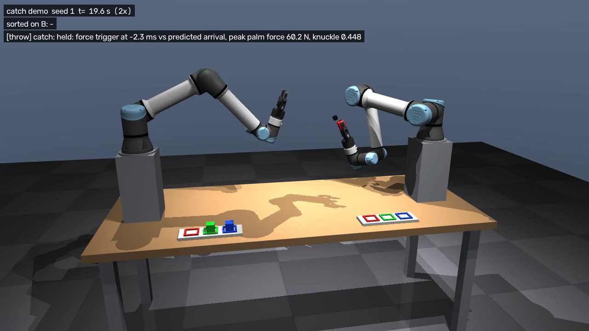
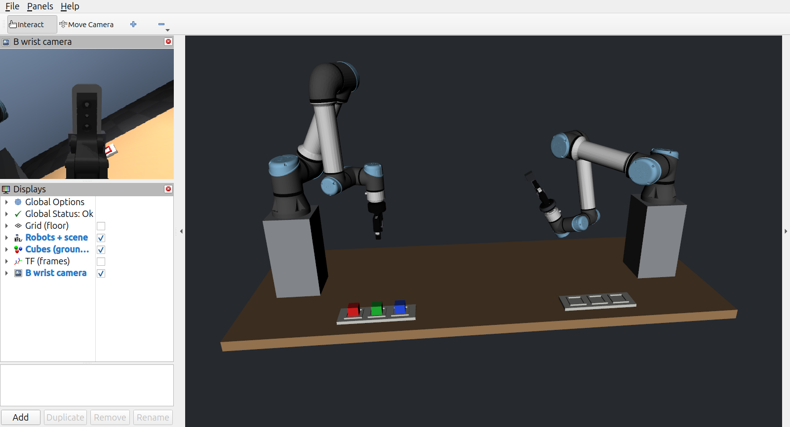
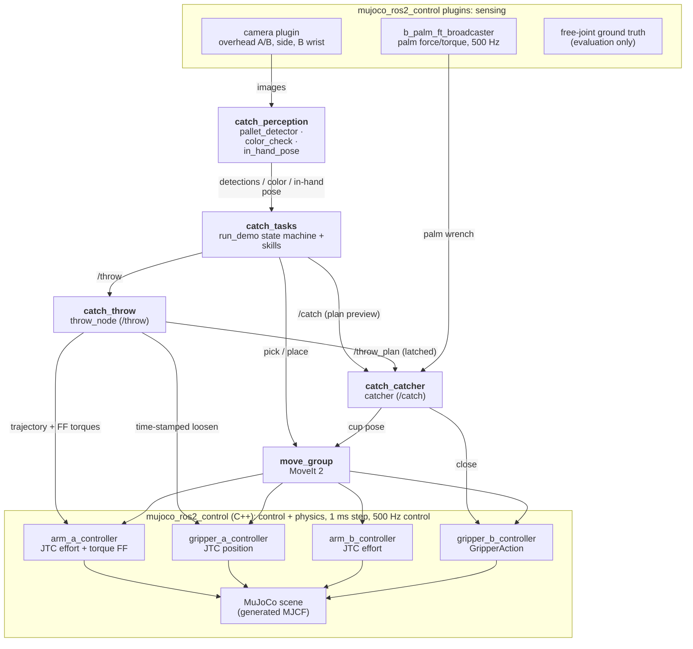
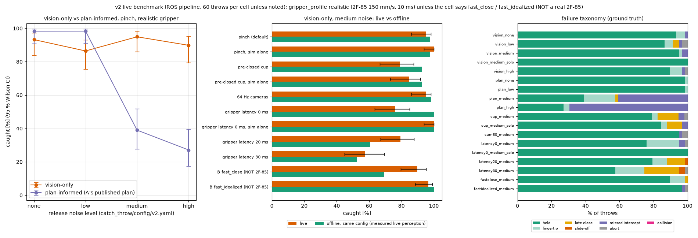

# catch — two UR5e arms that throw and catch colored cubes

ROS 2 Jazzy + MoveIt 2 + ros2_control on MuJoCo 3.12 (`mujoco_ros2_control` 0.1.1).

Robot **A** picks a random cube (red, green or blue) from its pallet, tosses it underhand across the table,
robot **B** catches it in the air with a Robotiq 2F-85, checks its color with a wrist camera, estimates how the cube
sits in its hand and puts it square into the slot of that color on its own pallet — until all three are sorted.

**v2 (default):** A throws a *random* throw with release noise; B starts from a fixed ready pose, sees the cube
only through two cameras, moves to intercept it while re-planning at ~39 Hz and closes its pre-opened fingers on
it ("pinch"), with the real 2F-85's closing speed modelled — see [v2](#v2-random-throws-vision-only-catch-from-a-ready-pose).
**v1** (`run_demo --v1`): one configured throw, B pre-positions from A's published plan ("cup" catch, fingers close
when the cube hits the palm).



Demo video: [`docs/media/demo_seed1.mp4`](docs/media/demo_seed1.mp4) (full run, 2x between throws, real time
around each throw, 0.25x close-up of every catch). Catch clips: [`docs/media/`](docs/media).

## What it does, step by step
1. **Detect** — overhead camera over A's pallet, HSV segmentation → cube position, yaw, color (1.7 mm mean error).
2. **Pick** (A, MoveIt) the randomly chosen cube (seeded), turn palm-up, let the cube drop onto the palm insert, re-grip.
3. **Pre-position** (B) — from the published throw plan B computes the intercept on the descending arc and the
   "cup" pose (tool z against the incoming velocity, fingers open, elbow up, ≥ 58 mm from the flight path) and
   moves there with MoveIt *before* A throws.
4. **Throw** (A) — a time-parameterised joint trajectory with inverse-dynamics torque feed-forward, sent directly
   to the JointTrajectoryController. The grip is loosened mid-stroke by a time-stamped trajectory on the gripper
   controller; the arm's deceleration releases the cube (2.14 m/s, 65°, 0.44 s flight, 0.4 m).
5. **Catch** (B) — the fingers close when the palm force sensor sees the impact (contact trigger). The cube is
   held by contact and friction only (no weld; a test enforces this).
6. **Color check** — B's wrist camera, never A's label (A's color is logged as a cross-check only).
7. **In-hand pose** — wrist camera looks along the closing axis; a 40 mm square is fitted to the visible cube
   face → rotation about the closing axis and offset in the hand.
8. **Place** (B) — top-down into the slot, tool tilted so the cube's faces are square to the slot.
9. **Verify** — overhead camera over B's pallet. A dropped cube is logged, put back on A's pallet (sim reset)
   and thrown again.

## How to run
Prerequisites: Ubuntu 24.04, ROS 2 Jazzy, MoveIt 2, `ros-jazzy-mujoco-ros2-control` 0.1.1 (packages.ros.org), an
NVIDIA GPU (PRIME offload is set by the launch files; see `docs/m0_toolchain.md`). No special apt versions: the
workspace pins its own robot descriptions (`robotiq_description` 0.0.1, `ur_description` 3.5.1, jazzy release
tags as submodules in `src/external/`), which overlay whatever is installed under `/opt/ros`.

```bash
git submodule update --init            # pinned MuJoCo Menagerie + robot descriptions
source /opt/ros/jazzy/setup.bash
colcon build --allow-overriding robotiq_description ur_description && source install/setup.bash
ros2 launch catch_bringup bringup.launch.py              # sim window + controllers + MoveIt + RViz
ros2 run catch_tasks run_demo --seed 1                   # in a second terminal: the full loop (v2; --v1 for v1)
```
Headless: `ros2 launch catch_bringup bringup.launch.py headless:=true rviz:=false`.



RViz default: both arms (B at its ready pose here, with its wrist depth camera), table, pallets, the cubes
(ground-truth markers, display only) and B's live wrist-camera image.

Evaluations (each needs the bringup running):

| | Command |
|---|---|
| FK URDF vs MJCF (venv) | `env -u PYTHONPATH .venv/bin/python -m pytest src/catch_description/test` |
| unit tests (system python) | see `CLAUDE.md` |
| throw, 20 throws | `ros2 run catch_tasks throw_eval --throws 20` |
| catch + place, 30 throws | `ros2 run catch_tasks catch_eval --throws 30 [--trigger time] [--no-correction]` |
| full loop, recorded | v2: `tools/v2_live/run_demo_v2.sh 1 2 3`, v1: `tools/run_m6.sh 1 2 3` (sim, rosbag, `run_demo` per seed) |
| v2 tracker vs ground truth, 50 throws | `ros2 run catch_tasks tracker_eval --throws 50` |
| v2 reactive catch, 60 throws | `ros2 run catch_tasks reactive_eval --mode pinch --source vision --noise medium --throws 60` |
| v2 benchmark (15 cells) | `tools/v2_live/bench.sh` → `tools/v2_live/plot_bench.py` (venv) |
| demo video | `env -u PYTHONPATH .venv/bin/python tools/render_demo.py log/m6/run_seed1.npz docs/m6/run_seed1.json --out docs/media/demo_seed1.mp4` |
| architecture diagram | `tools/export_architecture.sh` (README Mermaid block → `docs/media/architecture.svg`) |
| CPU per node | `python3 tools/node_cpu.py --seconds 30` (sim running) |

## Architecture



Top to bottom: sensing (sim plugins) → perception and decisions (ROS 2 nodes) → controllers → physics; every
arrow points down. Ground truth is published for evaluation only and feeds nothing.

<details><summary>Mermaid source (the SVG is exported from this block by <code>tools/export_architecture.sh</code>)</summary>



</details>

Packages: `catch_description` (scene YAML → URDF + generated MJCF, FK tests), `catch_sim` (controllers, scene
reset/spawn, monitors), `catch_moveit_config`, `catch_ballistics` (numpy/scipy-only projectile + solvers),
`catch_kinematics` (UR5e FK/IK), `catch_throw`, `catch_catcher`, `catch_perception`, `catch_tasks`
(skills, state machine, evaluation tools), `catch_interfaces`, `catch_bringup`. Offline tools (feasibility, feed-
forward table, catch study, replay rendering) live in `tools/` and run in the isolated `.venv`.

## Measured numbers
All in simulation; ground truth (MuJoCo free-joint state) is used only to *evaluate*. Details per milestone in `docs/`.
This table is v1 (M1–M6); the v2 benchmark is in the [v2 section](#v2-random-throws-vision-only-catch-from-a-ready-pose).

| What | Result |
|---|---|
| Throw feasibility (M1) | peak joint speed 0.80, torque 0.64 of the UR5e limits; ≥ 1.61 rad position margin; 4.8 cm clearance |
| URDF vs MJCF forward kinematics (M2) | ≤ 1e-6 mm / 1e-5° (tool0, TCP, gripper base, wrist camera); gripper collision geometry ≤ 0.84 mm |
| Static grasp slip, 10 s at up to 2.1 rad/s (M2, re-run after M5) | A 1.44–1.63 mm in 7 of 8 runs, one 2.35 mm outlier; B 1.43–1.60 mm in 6 runs (limit 2 mm) |
| Cube detection, overhead camera (M3) | 1.7 mm mean / 4.7 mm max position, 0.4° yaw |
| Release velocity, 20 throws (M4 / after M5) | speed error +8.2 ± 1.8 mm/s, direction 0.26°, spin −1.89 rad/s; catch-height crossing (4.2, 1.6) mm off the plan |
| **Catch, 30 throws (10 per color, M5, v1)** | **30 / 30**, contact trigger −2.7 ± 0.7 ms vs predicted arrival (v1 sim gripper, ~3× faster than a 2F-85); **30 / 30 (placed 30 / 30) again with the realistic 2F-85 model** — v1's pre-positioned cup holds the cube at rest in the palm while even a 150 mm/s close takes 340 ms, so v1 does not depend on the closing speed |
| Color check from B's wrist camera | 30 / 30 |
| In-hand pose (wrist camera) vs ground truth | angle error −0.14 ± 0.22° (max 0.75°), offset error ≤ 0.3 mm; off-centre catches (up to 18° in the hand): ≤ 0.7° / 0.7 mm |
| **Place error**, 30 catches | **30 / 30 in slot**, x −0.70 ± 0.07 mm, **yaw 0.00°** (without in-hand correction: +1.67 ± 1.19 mm; off-centre catches uncorrected: 0 / 9 in slot) |
| Full loop, 3 seeds + 1 injected fault (M6) | 4 / 4 runs complete, 96–99 s per run (124 s with one recovery), VERIFY agrees with ground truth 12 / 12 |
| Real-time factor | 1.000 (one 30 s window at 0.83 while rendering video offline in parallel) |
| Python node CPU at idle (v1.0) | all nodes 309 % of a core (643 % before taking /clock off the multi-threaded executors) |

## What is idealized (read this before trusting the numbers)
* **Exact-model torque feed-forward.** The throw's feed-forward torques come from inverse dynamics of *the same*
  MuJoCo model that simulates the arm. On a real robot the model error would show up as release-velocity error;
  without feed-forward the release was 0.26 m/s (12 %) too fast and 55 mm long (M4).
* **Torque-controlled arms, unlike a real UR.** The JTCs command joint *torques* (PD + feed-forward) at 500 Hz.
  A real UR5e takes position/velocity targets through its own controller (or torque via the newer direct
  torque interface) with its own latency and tracking behaviour; the throw would have to be re-tuned on hardware.
* **Ideal sensing.** Cameras are noise-free renders with fixed lighting; the palm force sensor is a perfect MuJoCo
  force sensor on a welded palm-insert body (a real palm would need a load cell or the gripper's current); joint
  states are exact. Detection, color and in-hand pose errors here are lower bounds.
* **Known release state (v1 only).** v1's B pre-positions from A's published *plan*; that is why v1 needs no
  vision (release scatter ~7 mm/s). v2's B tracks the cube with two cameras — but the cameras are still ideal
  renders (see above), at a rate (128.7 Hz) and latency (5 ms) a real system would have to earn.
* **Gripper closing speed.** v1's sim gripper closed ~3× faster than a real 2F-85 (150 mm/s); the v1 cup catch does
  not depend on it (30/30 with the realistic model too), the v2 catches from the ready pose do. v2 commands both
  grippers through a 2F-85 model (150 mm/s ramp, 10 ms command latency from the Robotiq manual — an estimate, not a
  measurement); `fast_close` / `fast_idealized` exist only as labelled benchmark cells. The MuJoCo finger actuator
  additionally lags its reference ramp by ~10 ms.
* **Sim timing.** Catch rates drop under CPU load (three sims in parallel cost up to 24 points, v2.0): the planner,
  the tracker and the controllers share the machine with the physics; the v2.1 numbers are with one sim alone (RTF
  1.000), and a real robot would need the same headroom.
* **Sim contacts.** Soft MuJoCo contacts (tuned solref/solimp, 1 ms step, elliptic cones) decide whether the cube
  bounces off the palm; real impacts (rubber pads, compliance, cube material) differ.
* **Pedestals.** Both arms stand on 0.35 m pedestals: the original geometry (arms on the table, 0.7 m flight)
  needs up to 2.7x the UR5e joint-speed limit (M1).
* **Demo noise.** v1: no injected noise (the seeded randomness is only the cube order). v2: random library throws with
  the medium release noise level (seeded). Drops are rare, so the
  recovery path is exercised with an opt-in, logged fault injection (late grip loosen).
* **Scene reset.** Recovering from a drop teleports the cube back to A's pallet (sim service), it is not picked
  up from the floor.

## v2: random throws, vision-only catch from a ready pose
What changed (`docs/v2_phase2.md`; offline feasibility study first: `docs/v2_phase1_feasibility.md`):
* **Random throws.** A throws a random entry (seeded) of a precomputed library (`catch_throw/config/library_*.json`:
  241 pinch / 121 square-arrival throws, each with its own MuJoCo feed-forward and a hash of its inputs) with
  Gaussian release noise (none / low / medium / high: up to 1.2 % speed, 0.72° direction, 10 ms timing).
* **B sees only the cameras.** Two fixed 320×240 cameras at 128.7 Hz; a C++ tracker (`catch_tracker`: HSV components,
  3D-gated stereo pairs, ballistic least squares with covariance) publishes the predicted intercept **5 ms** after
  the render (median); B's vision node has no access to A's plan (enforced by a test).
* **Reactive intercept** (`catch_catcher/reactive_node.py`): B waits at a ready pose with the fingers pre-opened to
  56 mm, commits ~75 ms after the first estimate, then replaces its arm trajectory at ~39 Hz (4 ms per re-plan,
  joint speed ≤ 85 %, torque ≤ 80 % by inverse dynamics, capsule collision check of every plan) and closes the
  fingers on a schedule that accounts for the 2F-85's 150 mm/s and 10 ms command latency ("pinch").
* **The real 2F-85 speed everywhere.** Both grippers are commanded through a 2F-85 model (`catch_sim/gripper_model.py`);
  the v1 sim gripper closed ~3× faster (v1's cup catch does not depend on it, see the measured numbers).

**Live benchmark** (v2.1: every cell alone, one sim at a time, 60 throws per cell, ground truth, real-time factor
≥ 0.996 in every 2 s window; `docs/v2/phase2/bench_table.md`; realistic 2F-85 unless marked). Offline = the same throws and
release-noise draws in the offline MuJoCo model (`tools/v2_live/offline_cells.py`):

| | live | offline, same throws |
|---|---|---|
| **camera-only pinch, medium noise (default)** | **100 % [94–100]** | 98 % |
| camera-only pinch, noise none / low / high | 100 / 100 / 95 % | 100 / 100 / 100 % |
| plan-informed (A's published plan), noise none / low / medium / high | 100 / 100 / 39 / 22 % | — |
| pre-closed cup (fingers at 56 mm, contact close), medium | 90 % [79–95] | 87 % |
| cameras at 64 Hz instead of 128.7 Hz | 97 % [88–99] | 97 % |
| gripper latency 0 / 20 / 30 ms (B assumes 10) | 97 / 71 / 64 % | 100 / 67 / 50 % |
| B's gripper fast_close / fast_idealized (**NOT a 2F-85**) | 88 / 100 % | 80 / 100 % |

Camera-only barely notices the release noise (it re-estimates the flight; the noise moves the arrival by up to
15 cm), plan-informed collapses. With three sims in parallel (v2.0) the camera-only cells lost up to 24 points to the
slower re-planning (`docs/v2_phase2.md`, "Under load").

**v2.2: B measures its own gripper's delay.** Before its first catch, B moves its fingers a little and times the
response from `/joint_states` (command latency + actuator lag). With that, a 2F-85 that reacts 10 / 20 ms later than
assumed no longer costs anything: 59/59 = 100 % at 0 / 10 / 20 / 30 ms true latency (v2.1, assuming 10 ms: 97 / 100 /
71 / 64 %); `docs/v2_phase2.md` "v2.2". Also fixed: 3–4 % of B's trajectory updates were rejected by the controller
(duplicate point times), and 13 + 9 library throws whose stroke start MoveIt cannot reach are skipped.



**Full loop, 3 seeds, medium noise:** 9/9 throws caught on the first try, 9/9 placed (≤ 1.1 mm, ground truth), VERIFY
agrees with ground truth 9/9. Video: [`docs/media/demo_v2_seed1.mp4`](docs/media/demo_v2_seed1.mp4) (B starts every
catch from its ready pose; real time around each throw, 0.25× close-ups). Failure clips from the benchmark:
`docs/media/v2_fail_{missed_intercept,late_close,slide_off,fingertip,abort}.mp4` (no collision occurred).

**v2.3: B's arm configuration.** The reactive planner never changed IK branch during a catch (0 changes in 310
recorded trials); the visible wrist flips were the moves home ⇄ ready around it (wrist 2 through 0 twice per throw).
An elbow-up ready pose on home's branch (no flip, elbow 15 cm above the shoulder) with the branch fixed catches only
51 % (60° approach) / 56 % (55°) of the same throws against 100 % for the Phase 1 pose: waiting higher, B cannot reach
the low arrivals of A's throw library in time. The Phase 1 pose stays the default; the elbow-up poses are
`reactive.yaml` variants (`CATCH_READY_POSE`, `ik_branch: fixed`). In the demo B now waits at home and gets ready
while A loads (0.5–3.6 s early, runs 78–84 s instead of 86–92 s). B's wrist camera is a 42 × 42 × 23 mm depth camera
on a clamp mount now (capsule model checked against MuJoCo and MoveIt's meshes). `docs/v2_arm_config.md`.

v1 numbers with the realistic gripper: the v1 catch evaluation (plan-informed cup, configured throw) still catches
**30/30** (placed 30/30) and M4 throws 20/20. The v1 headline 30/30 was measured with the faster v1 sim gripper, but
does not depend on it: the pre-positioned cup holds the cube at rest in the palm (≤ 6 mm drift) for the 340 ms a
150 mm/s close takes (`tools/v2_live/v1_close_analysis.py`).

## Documentation
`docs/progress.md` (milestone log) and per milestone `docs/m0_toolchain.md`, `m1_feasibility.md`,
`m2_scene_bringup.md`, `m3_perception_pick_place.md`, `m4_throw.md`, `m5_catch.md`, `m6_full_loop.md`;
v2: `v2_phase1_feasibility.md`, `v2_phase2.md`, `v2_arm_config.md` (v2.3).
