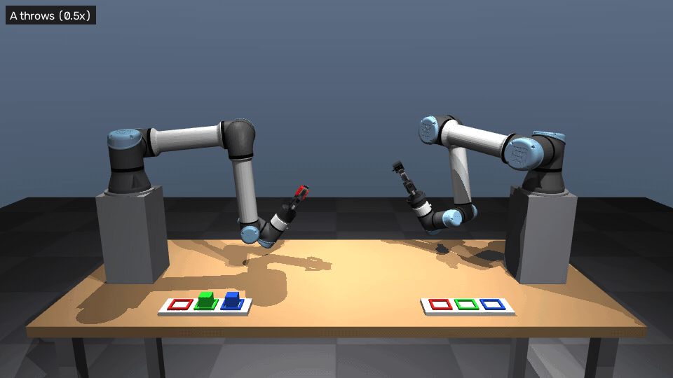
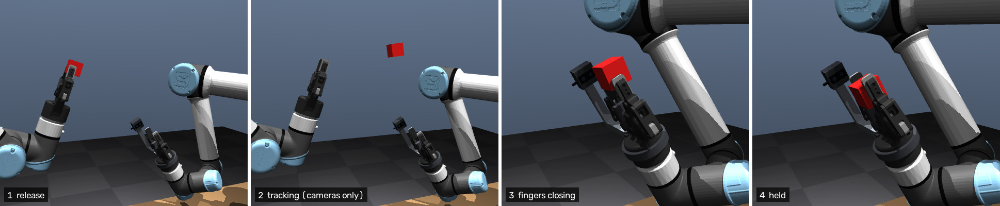
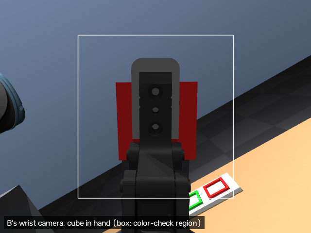
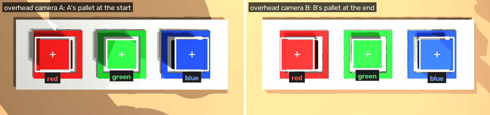
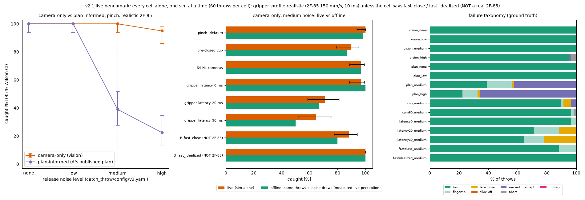

# catch-me-if-you-can

**Two UR5e arms throw and catch colored cubes: camera-only reactive catching in ROS 2 Jazzy + MuJoCo.**

[](https://docs.ros.org/en/jazzy/)
[](https://mujoco.org/)
[](https://moveit.ai/)
[](LICENSE)

Robot A picks a random cube and tosses it across the table with a random, noisy throw. Robot B sees the cube only
through two cameras, chases the intercept while re-planning ~39 times a second, closes a Robotiq 2F-85 on it in
mid-air, checks its color with a wrist camera and places it square into the matching slot.



Full run, three throws, real time around each throw and slow-motion close-ups: [`docs/media/demo.mp4`](docs/media/demo.mp4)

## Highlights

* **Camera-only catch from a fixed ready pose: 59/59 throws (100 %, 95 % CI 94–100 %)** at the default release noise,
  with the real 2F-85 closing speed modelled ([benchmark](docs/results.md#v2-live-benchmark)).
* **5 ms perception latency** from render to intercept estimate, 128.7 Hz stereo, predicted intercept within 9.7 mm
  0.2 s before arrival ([latency budget](docs/results.md#latency-budget)).
* **~39 Hz re-planning:** B replaces its arm trajectory every ~26 ms (4 ms per plan) within 85 % joint speed and 80 %
  torque ([latency budget](docs/results.md#latency-budget)).
* **Gripper delay probe:** B measures its own gripper's latency before catching and stays at **100 % with 0–30 ms of
  true latency**, versus 64–97 % when the true latency differed from the 10 ms it used to assume
  ([v2.2](docs/results.md#gripper-delay-probe-v22)).
* **Cameras beat the plan under noise:** as release noise rises, camera-only stays at 100 / 100 / 100 / 95 % while
  pre-positioning from A's published plan falls to 100 / 100 / 39 / 22 %
  ([noise](docs/results.md#does-the-camera-only-catch-notice-the-release-noise)).
* **The natural-looking pose catches less:** an elbow-up ready pose catches only **51–56 % vs 100 %**, because A's
  throws arrive low and B cannot drop 20 cm in time ([arm configuration](docs/results.md#arm-configuration-v23),
  [full report](https://github.com/JaisalJain/catch-me-if-you-can/blob/fdbb13f435c2b5288b07e24d6d3cec28657a7f4e/docs/v2_arm_config.md)).
* **Full loop:** 3 seeds × 3 cubes, **9/9 caught on the first throw, 9/9 placed ≤ 1.1 mm** from the slot centre
  (ground truth) ([full loop](docs/results.md#full-loop)).

## Gallery

<table>
  <tr>
    <td colspan="2"></td>
  </tr>
  <tr>
    <td colspan="2" align="center"><sub>Release → tracking (cameras only) → fingers closing → held</sub></td>
  </tr>
  <tr>
    <td width="62%"></td>
    <td width="38%"></td>
  </tr>
  <tr>
    <td align="center"><sub>RViz: both arms and B's live wrist-camera image</sub></td>
    <td align="center"><sub>B's wrist camera: cube in hand, color-check region</sub></td>
  </tr>
  <tr>
    <td colspan="2"></td>
  </tr>
  <tr>
    <td colspan="2" align="center"><sub>Overhead pallet detection (HSV segmentation, 1.7 mm mean error): A's pallet at the start, B's at the end</sub></td>
  </tr>
</table>

## How it works


A C++ tracker fits a ballistic trajectory to stereo detections of the cube and publishes the predicted intercept;
B's reactive catcher commits ~75 ms after the first estimate, keeps replacing its arm trajectory as the estimate
improves and times the finger close from the measured gripper delay. A's throws come from a library of 241
precomputed strokes with MuJoCo inverse-dynamics feed-forward, and everything else (pick, place) goes through
MoveIt. Step by step, packages and every command: [docs/how_it_works.md](docs/how_it_works.md).

## Quick start

<details>
<summary>Prerequisites</summary>

* Ubuntu 24.04 with [ROS 2 Jazzy](https://docs.ros.org/en/jazzy/Installation/Ubuntu-Install-Debs.html) (desktop)
  and `python3-rosdep`, `python3-colcon-common-extensions`.
* An NVIDIA GPU (cameras and the sim window render on it; on a PRIME laptop the launch file selects the dGPU itself).
* `rosdep` installs the rest from packages.ros.org: MoveIt 2, ros2_controllers and
  `ros-jazzy-mujoco-ros2-control` 0.1.1 (MuJoCo 3.12).
* The UR and Robotiq descriptions are pinned as submodules in `src/external/` and overlay whatever is installed under
  `/opt/ros`. `git submodule update --init` without a path also fetches MuJoCo Menagerie (~2 GB), which is only
  needed to regenerate the MJCF.

</details>

```bash
git clone https://github.com/JaisalJain/catch-me-if-you-can.git && cd catch-me-if-you-can
git submodule update --init src/external          # pinned UR + Robotiq descriptions
source /opt/ros/jazzy/setup.bash
rosdep install --from-paths src --ignore-src -y
colcon build --allow-overriding robotiq_description ur_description
source install/setup.bash
ros2 launch catch_bringup bringup.launch.py       # sim window, controllers, MoveIt, RViz
```

Then, in a second terminal (`source install/setup.bash`), run three throws, catches and placements:

```bash
ros2 run catch_tasks run_demo --seed 1
```

## Try it

Each `ros2 run` needs the bringup running in another terminal.

| scenario | command |
|---|---|
| full loop (v2: random throws, camera-only catch) | `ros2 run catch_tasks run_demo --seed 1` |
| v1 loop (one configured throw, B pre-positions from A's plan) | `ros2 run catch_tasks run_demo --v1 --seed 1` |
| one benchmark cell, 60 throws | `ros2 run catch_tasks reactive_eval --mode pinch --source vision --noise medium --throws 60` |
| tracker vs ground truth, 50 throws | `ros2 run catch_tasks tracker_eval --throws 50 --seed 1` |
| headless (no sim window, no RViz) | `ros2 launch catch_bringup bringup.launch.py headless:=true rviz:=false` |
| elbow-up ready pose variant | `CATCH_READY_POSE=home_style CATCH_IK_BRANCH=fixed ros2 launch catch_bringup bringup.launch.py` |

## Results

Live ROS pipeline, one sim alone, 60 throws per cell from A's random throw library, scored against ground truth.



| cell (realistic 2F-85) | caught [95 % CI] |
|---|---|
| **camera-only pinch, medium release noise (default)** | **100 % [94–100]** |
| camera-only pinch, high noise | 95 % [86–98] |
| plan-informed (A's published plan), medium / high noise | 39 % / 22 % |
| pre-closed cup instead of pinch, medium noise | 90 % [79–95] |
| gripper reacts 30 ms late: assumed (v2.1) → probed (v2.2) | 64 % → 100 % |

All 15 cells, latency budget, v1 numbers and the full-loop runs: [docs/results.md](docs/results.md).

## What's idealized

* Cameras are noise-free renders with ideal calibration; 5 ms latency is what a real stereo pair would have to earn.
* The arms are torque-controlled with exact-model feed-forward (a real UR5e takes position/velocity targets).
* The 2F-85's speed and 10 ms command latency are modelled from the manual, not measured on hardware.
* Contacts are soft MuJoCo contacts; release noise is Gaussian and independent per throw.
* Both arms stand on 0.35 m pedestals, and a dropped cube is teleported back to A's pallet.

Full list: [docs/idealizations.md](docs/idealizations.md).

## Docs

* [How it works](docs/how_it_works.md): the cycle step by step, architecture, packages, all commands
* [Results](docs/results.md): v2 benchmark, latency budget, gripper delay probe, arm configuration, full loop, v1
* [What's idealized](docs/idealizations.md)
* Archived milestone reports (M0–M6, v2 Phase 1 / Phase 2, v2.3 arm configuration) and raw data:
  [docs at `fdbb13f`](https://github.com/JaisalJain/catch-me-if-you-can/tree/fdbb13f435c2b5288b07e24d6d3cec28657a7f4e/docs),
  indexed in [results.md](docs/results.md#full-reports-archived)

## License

[Apache-2.0](LICENSE), © 2026 Jaisal K Jain. Robot models and meshes from MuJoCo Menagerie, `ur_description` and
`robotiq_description` keep their BSD licenses: [THIRD_PARTY_NOTICES.md](THIRD_PARTY_NOTICES.md).

**Author:** Jaisal K Jain
