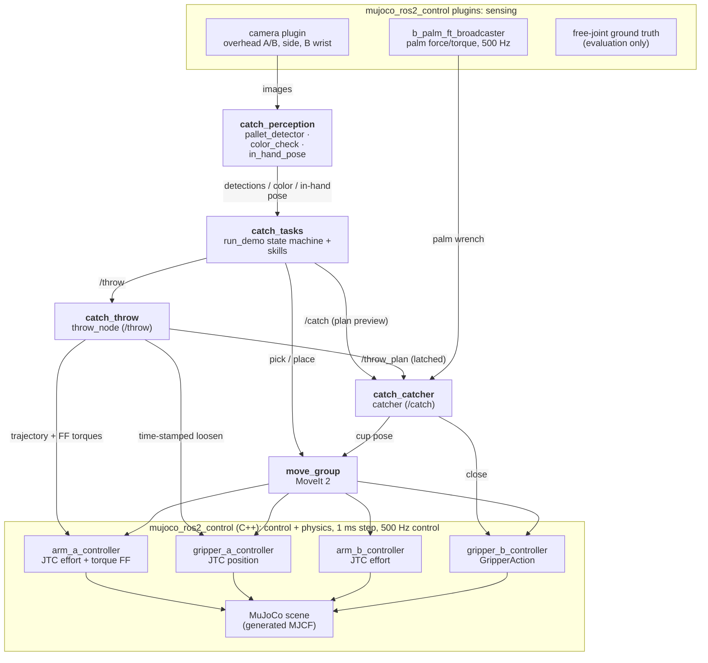

# catch — two UR5e arms that throw and catch colored cubes

ROS 2 Jazzy + MoveIt 2 + ros2_control on MuJoCo 3.12 (`mujoco_ros2_control` 0.1.1).

Robot **A** picks a random cube (red, green or blue) from its pallet, tosses it underhand across the table,
robot **B** catches it in the air with an open Robotiq 2F-85 ("cup" catch: palm against the incoming velocity,
fingers close when the cube hits the palm), checks its color with a wrist camera, estimates how the cube sits
in its hand and puts it square into the slot of that color on its own pallet — until all three are sorted.


Demo video: [`docs/media/demo_seed1.mp4`](docs/media/demo_seed1.mp4) (full run, 2x between throws, real time
around each throw, 0.25x close-up of every catch). Catch clips: [`docs/media/`](docs/media).

## What it does, step by step
1. **Detect** — overhead camera over A's pallet, HSV segmentation → cube position, yaw, color (1.7 mm mean error).
2. **Pick** (A, MoveIt) the randomly chosen cube (seeded), turn palm-up, let the cube drop onto the palm insert, re-grip.
3. **Pre-position** (B) — from the published throw plan B computes the intercept on the descending arc and the
   "cup" pose (tool z against the incoming velocity, fingers open, elbow up, ≥ 58 mm from the flight path) and
   moves there with MoveIt *before* A throws.
4. **Throw** (A) — a time-parameterised joint trajectory with inverse-dynamics torque feed-forward, sent directly
   to the JointTrajectoryController. The grip is loosened mid-stroke by a time-stamped trajectory on the gripper
   controller; the arm's deceleration releases the cube (2.14 m/s, 65°, 0.44 s flight, 0.4 m).
5. **Catch** (B) — the fingers close when the palm force sensor sees the impact (contact trigger). The cube is
   held by contact and friction only (no weld; a test enforces this).
6. **Color check** — B's wrist camera, never A's label (A's color is logged as a cross-check only).
7. **In-hand pose** — wrist camera looks along the closing axis; a 40 mm square is fitted to the visible cube
   face → rotation about the closing axis and offset in the hand.
8. **Place** (B) — top-down into the slot, tool tilted so the cube's faces are square to the slot.
9. **Verify** — overhead camera over B's pallet. A dropped cube is logged, put back on A's pallet (sim reset)
   and thrown again.

## How to run
Prerequisites: Ubuntu 24.04, ROS 2 Jazzy, MoveIt 2, `ros-jazzy-mujoco-ros2-control` 0.1.1 (packages.ros.org), an
NVIDIA GPU (PRIME offload is set by the launch files; see `docs/m0_toolchain.md`). No special apt versions: the
workspace pins its own robot descriptions (`robotiq_description` 0.0.1, `ur_description` 3.5.1, jazzy release
tags as submodules in `src/external/`), which overlay whatever is installed under `/opt/ros`.

```bash
git submodule update --init            # pinned MuJoCo Menagerie + robot descriptions
source /opt/ros/jazzy/setup.bash
colcon build --allow-overriding robotiq_description ur_description && source install/setup.bash
ros2 launch catch_bringup bringup.launch.py              # sim window + controllers + MoveIt + RViz
ros2 run catch_tasks run_demo --seed 1                   # in a second terminal: the full loop
```
Headless: `ros2 launch catch_bringup bringup.launch.py headless:=true rviz:=false`.

Evaluations (each needs the bringup running):

| | Command |
|---|---|
| FK URDF vs MJCF (venv) | `env -u PYTHONPATH .venv/bin/python -m pytest src/catch_description/test` |
| unit tests (system python) | see `CLAUDE.md` |
| throw, 20 throws | `ros2 run catch_tasks throw_eval --throws 20` |
| catch + place, 30 throws | `ros2 run catch_tasks catch_eval --throws 30 [--trigger time] [--no-correction]` |
| full loop, recorded | `log/run_m6.sh 1 2 3` (sim, recorder, `run_demo` per seed) |
| demo video | `env -u PYTHONPATH .venv/bin/python tools/render_demo.py log/m6/run_seed1.npz docs/m6/run_seed1.json --out docs/media/demo_seed1.mp4` |
| architecture diagram | `tools/export_architecture.sh` (README Mermaid block → `docs/media/architecture.svg`) |
| CPU per node | `python3 tools/node_cpu.py --seconds 30` (sim running) |

## Architecture


Top to bottom: sensing (sim plugins) → perception and decisions (ROS 2 nodes) → controllers → physics; every
arrow points down. Ground truth is published for evaluation only and feeds nothing.

<details><summary>Mermaid source (the SVG is exported from this block by <code>tools/export_architecture.sh</code>)</summary>



</details>

Packages: `catch_description` (scene YAML → URDF + generated MJCF, FK tests), `catch_sim` (controllers, scene
reset/spawn, monitors), `catch_moveit_config`, `catch_ballistics` (numpy/scipy-only projectile + solvers),
`catch_kinematics` (UR5e FK/IK), `catch_throw`, `catch_catcher`, `catch_perception`, `catch_tasks`
(skills, state machine, evaluation tools), `catch_interfaces`, `catch_bringup`. Offline tools (feasibility, feed-
forward table, catch study, replay rendering) live in `tools/` and run in the isolated `.venv`.

## Measured numbers
All in simulation; ground truth (MuJoCo free-joint state) is used only to *evaluate*. Details per milestone in `docs/`.

| What | Result |
|---|---|
| Throw feasibility (M1) | peak joint speed 0.80, torque 0.64 of the UR5e limits; ≥ 1.61 rad position margin; 4.8 cm clearance |
| URDF vs MJCF forward kinematics (M2) | ≤ 1e-6 mm / 1e-5° (tool0, TCP, gripper base, wrist camera); gripper collision geometry ≤ 0.84 mm |
| Static grasp slip, 10 s at up to 2.1 rad/s (M2, re-run after M5) | A 1.44–1.63 mm in 7 of 8 runs, one 2.35 mm outlier; B 1.43–1.60 mm in 6 runs (limit 2 mm) |
| Cube detection, overhead camera (M3) | 1.7 mm mean / 4.7 mm max position, 0.4° yaw |
| Release velocity, 20 throws (M4 / after M5) | speed error +8.2 ± 1.8 mm/s, direction 0.26°, spin −1.89 rad/s; catch-height crossing (4.2, 1.6) mm off the plan |
| **Catch, 30 throws (10 per color, M5)** | **30 / 30**, contact trigger −2.7 ± 0.7 ms vs predicted arrival |
| Color check from B's wrist camera | 30 / 30 |
| In-hand pose (wrist camera) vs ground truth | angle error −0.14 ± 0.22° (max 0.75°), offset error ≤ 0.3 mm; off-centre catches (up to 18° in the hand): ≤ 0.7° / 0.7 mm |
| **Place error**, 30 catches | **30 / 30 in slot**, x −0.70 ± 0.07 mm, **yaw 0.00°** (without in-hand correction: +1.67 ± 1.19 mm; off-centre catches uncorrected: 0 / 9 in slot) |
| Full loop, 3 seeds + 1 injected fault (M6) | 4 / 4 runs complete, 96–99 s per run (124 s with one recovery), VERIFY agrees with ground truth 12 / 12 |
| Real-time factor | 1.000 (one 30 s window at 0.83 while rendering video offline in parallel) |
| Python node CPU at idle (v1.0) | all nodes 309 % of a core (643 % before taking /clock off the multi-threaded executors) |

## What is idealized (read this before trusting the numbers)
* **Exact-model torque feed-forward.** The throw's feed-forward torques come from inverse dynamics of *the same*
  MuJoCo model that simulates the arm. On a real robot the model error would show up as release-velocity error;
  without feed-forward the release was 0.26 m/s (12 %) too fast and 55 mm long (M4).
* **Torque-controlled arms, unlike a real UR.** The JTCs command joint *torques* (PD + feed-forward) at 500 Hz.
  A real UR5e takes position/velocity targets through its own controller (or torque via the newer direct
  torque interface) with its own latency and tracking behaviour; the throw would have to be re-tuned on hardware.
* **Ideal sensing.** Cameras are noise-free renders with fixed lighting; the palm force sensor is a perfect MuJoCo
  force sensor on a welded palm-insert body (a real palm would need a load cell or the gripper's current); joint
  states are exact. Detection, color and in-hand pose errors here are lower bounds.
* **Known release state.** B pre-positions from A's published *plan* (release position/velocity/time), not from
  observing the flight. Release scatter in this sim is ~7 mm/s; the catch tolerates roughly ±30 mm/s across the
  flight path (offline envelope, `docs/m5_catch.md`). With realistic throw noise B would have to track the cube
  (side camera, ballistic fit) and re-plan — the interfaces allow it but it is not built.
* **Sim contacts.** Soft MuJoCo contacts (tuned solref/solimp, 1 ms step, elliptic cones) decide whether the cube
  bounces off the palm; real impacts (rubber pads, compliance, cube material) differ.
* **Pedestals.** Both arms stand on 0.35 m pedestals: the original geometry (arms on the table, 0.7 m flight)
  needs up to 2.7x the UR5e joint-speed limit (M1).
* **Deterministic demo.** No injected noise; the seeded randomness is only the cube order. Drops are rare, so the
  recovery path is exercised with an opt-in, logged fault injection (late grip loosen).
* **Scene reset.** Recovering from a drop teleports the cube back to A's pallet (sim service), it is not picked
  up from the floor.

## Documentation
`docs/progress.md` (milestone log) and per milestone `docs/m0_toolchain.md`, `m1_feasibility.md`,
`m2_scene_bringup.md`, `m3_perception_pick_place.md`, `m4_throw.md`, `m5_catch.md`, `m6_full_loop.md`.
