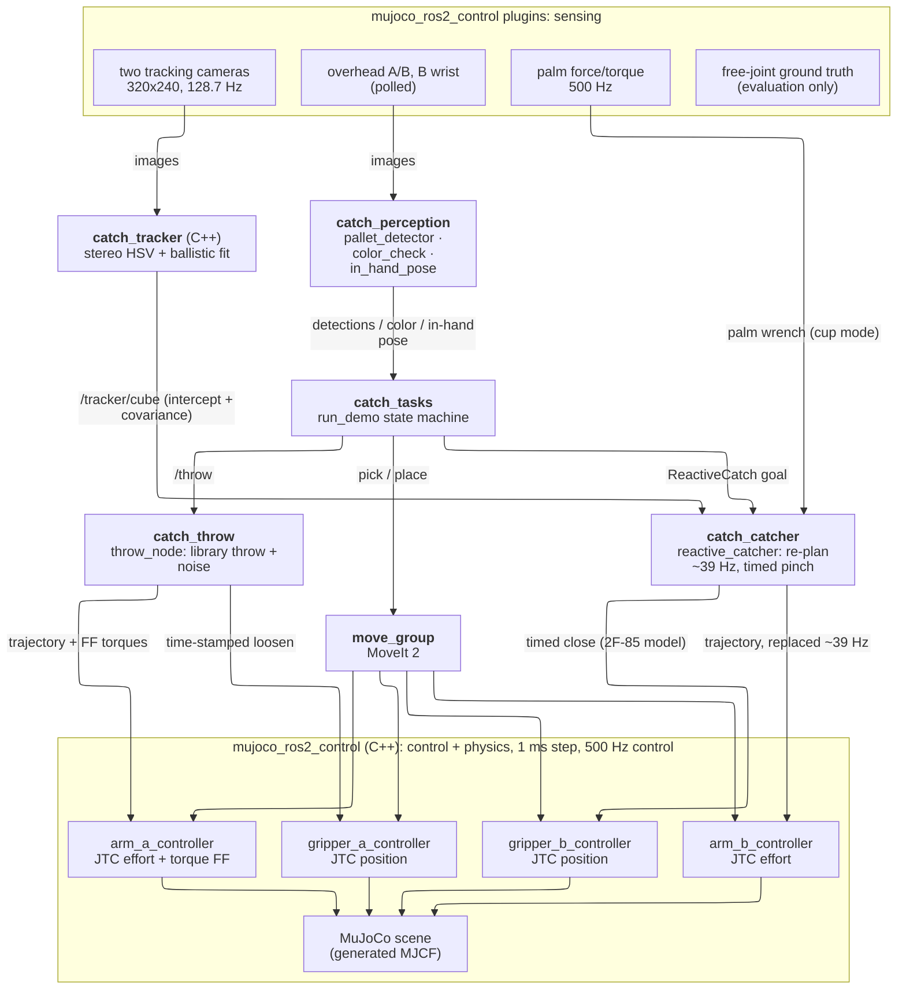

# How it works

Two UR5e arms with Robotiq 2F-85 grippers stand on pedestals at either end of a table, simulated in MuJoCo 3.12 and
driven through ROS 2 Jazzy, `ros2_control` (`mujoco_ros2_control` 0.1.1) and MoveIt 2. Robot **A** sorts three colored
cubes from its pallet by throwing them, one at a time, to robot **B**, which catches each one in the air and places
it in the slot of its color on its own pallet.

## One cycle (v2, the default)

1. **Detect.** The overhead camera over A's pallet finds the cubes: HSV segmentation → cube-top core → ray/plane
   intersection (1.7 mm mean position error, 0.4° yaw). A picks one at random (seeded).
2. **Pick and load.** A picks the cube with MoveIt, turns its palm up, lets the cube settle on the palm insert and
   re-grips. It draws a random throw from a precomputed library (241 throws, each with its own MuJoCo inverse-dynamics
   feed-forward) and moves to that throw's stroke start. Meanwhile B leaves its waiting pose (home), goes to its ready
   pose, pre-opens its fingers to 56 mm and probes its own gripper delay.
3. **Throw.** A's stroke is a time-parameterised joint trajectory with torque feed-forward, sent straight to its
   joint trajectory controller, with Gaussian release noise (medium: ~1.2 % speed, 0.7° direction, 5 ms timing). The
   grip is loosened mid-stroke by a time-stamped trajectory on A's gripper controller; the arm's deceleration
   releases the cube (~2 m/s, 0.3–0.5 s flight).
4. **Track.** B sees the cube only through two fixed 320×240 cameras at 128.7 Hz. A C++ tracker (`catch_tracker`)
   segments the cube in both views, pairs detections whose rays meet within 10 mm, fits a ballistic least-squares
   trajectory with covariance and publishes the predicted intercept 5 ms after each render. B never sees A's plan
   (a test enforces this).
5. **Catch.** About 75 ms after the first estimate B commits to an intercept and from then on replaces its arm
   trajectory at ~39 Hz (4 ms per re-plan; joint speed ≤ 85 %, torque ≤ 80 % of the UR5e limits by inverse dynamics,
   capsule collision check of every plan). The fingers close on a schedule that accounts for the 2F-85's 150 mm/s
   and the measured gripper delay, so they meet the cube as it arrives ("pinch"). The cube is held by contact and
   friction only; there is no weld.
6. **Color and in-hand pose.** B's wrist camera checks the color (never A's label) and, looking along the closing
   axis, fits a 40 mm square to the visible cube face to recover the cube's rotation and offset in the hand.
7. **Place and verify.** B places the cube top-down into the slot of its color, tilting the tool so the cube is
   square to the slot. The overhead camera over B's pallet verifies it. A dropped cube is logged, reset onto A's
   pallet and thrown again.

**v1** (`run_demo --v1`) is the first version: one configured throw, B pre-positions a "cup" pose from A's published
throw plan before the throw, and the fingers close when the palm force sensor feels the impact.

## Architecture


Top to bottom: sensing (simulator plugins) → perception and decisions (ROS 2 nodes) → controllers → physics. Ground
truth is published for evaluation only and feeds nothing. `tools/export_architecture.sh` renders the SVG from the
Mermaid block below.

<details><summary>Mermaid source</summary>



</details>

## Packages

| package | what |
|---|---|
| `catch_description` | scene YAML → URDF/xacro (MoveIt) and generated MJCF (MuJoCo); FK agreement tests |
| `catch_sim` | sim bringup, controllers, scene reset/spawn, ground truth, 2F-85 gripper model, monitors |
| `catch_moveit_config` | MoveIt 2 config: groups `arm_a`, `arm_b`, `gripper_a`, `gripper_b` (one move_group) |
| `catch_ballistics` | projectile model, release-velocity and intercept solvers (numpy/scipy only) |
| `catch_kinematics` | UR5e FK, Jacobian, analytic IK with branch selection, capsule collision model (numpy only) |
| `catch_throw` | A's throw: trajectory generator, feed-forward tables, throw library, throw action node |
| `catch_tracker` | v2 flight tracking: stereo cube detection + ballistic least squares (C++ composable node) |
| `catch_catcher` | B: reactive camera-only intercept (v2) and the plan-informed cup catch (v1) |
| `catch_perception` | overhead cube detection, color check and in-hand pose from B's wrist camera |
| `catch_tasks` | skills, MoveIt client, the `run_demo` state machine, evaluation tools, recorder |
| `catch_interfaces` | messages, services and actions |
| `catch_bringup` | top-level launch file and RViz config |

`src/external/` pins `ur_description` and `robotiq_description` (submodules at their Jazzy release tags) as a
workspace overlay; `third_party/mujoco_menagerie` (submodule) is only needed to regenerate the MJCF.

## Commands

Everything below needs the workspace built and sourced. Commands marked *bringup* need
`ros2 launch catch_bringup bringup.launch.py` running in another terminal (add `headless:=true rviz:=false` for
batch runs). Tools marked *venv* run in the offline Python environment:

```bash
python3 -m venv .venv && .venv/bin/pip install -r tools/requirements.txt
env -u PYTHONPATH .venv/bin/python tools/<tool>.py ...    # ROS's PYTHONPATH must not leak into the venv
```

| what | command |
|---|---|
| full loop, v2 (*bringup*) | `ros2 run catch_tasks run_demo --seed 1` |
| full loop, v1 (*bringup*) | `ros2 run catch_tasks run_demo --v1 --seed 1` |
| recorded full-loop batch (fresh sim per seed, rosbag2 → npz) | `tools/v2_live/run_demo_v2.sh 1 2 3` (v1: `tools/run_m6.sh 1 2 3`) |
| tracker vs ground truth, 50 throws (*bringup*) | `ros2 run catch_tasks tracker_eval --throws 50 --seed 1` |
| one benchmark cell, 60 throws (*bringup*) | `ros2 run catch_tasks reactive_eval --mode pinch --source vision --noise medium --throws 60` |
| whole benchmark, every cell alone (starts its own sims) | `tools/v2_live/bench_seq.sh`, table and plot: `tools/v2_live/plot_bench.py` (*venv*) |
| offline counterpart of every cell | `tools/v2_live/offline_cells.py` (*venv*) |
| v1 throw / catch evaluations (*bringup*) | `ros2 run catch_tasks throw_eval --throws 20`, `ros2 run catch_tasks catch_eval --throws 30` |
| ready-pose variant | `CATCH_READY_POSE=home_style CATCH_IK_BRANCH=fixed ros2 launch catch_bringup bringup.launch.py` |
| unit tests (system Python, no build needed) | `PYTHONPATH=src/catch_ballistics:src/catch_kinematics:src/catch_throw:$PYTHONPATH python3 -m pytest -q src/catch_{ballistics,kinematics,throw}/test` |
| package tests | `colcon test && colcon test-result --verbose` |
| URDF vs MJCF FK test (*venv*, ROS sourced) | `env -u PYTHONPATH .venv/bin/python -m pytest src/catch_description/test` |
| replay a recording to mp4 (*venv*) | `tools/render_replay.py rec.npz --out x.mp4 [--view catch\|throw\|overview]` |
| demo video / README media (*venv*) | `tools/render_demo.py rec.npz run.json --out demo.mp4`, `tools/render_readme_media.py rec.npz run.json` |
| CPU per node (sim running) | `python3 tools/node_cpu.py --seconds 30` |

After editing `src/catch_description/config/{scene,physics}.yaml`: regenerate the MJCF
(`src/catch_description/scripts/build_mjcf.py`, *venv*, needs the Menagerie submodule), then the throw feed-forward
table and library (`tools/throw_feedforward.py`, `tools/build_throw_library.py`, *venv*; `throw_node` refuses stale
tables), rebuild, and re-check the library against MoveIt (`python3 tools/v2_live/check_library_moveit.py`,
bringup running). The research tools write their results under `docs/` (ignored by git).

## GPU

Cameras and the sim window render on the GPU. On a PRIME laptop the launch file routes GL work to the NVIDIA dGPU
itself; for the offline tools `source tools/nv_env.sh` first (GLX PRIME offload for windows, NVIDIA EGL for offscreen
rendering, `MUJOCO_GL=egl`). Developed on an RTX 5060 Laptop GPU; other GPUs should work but are untested.
