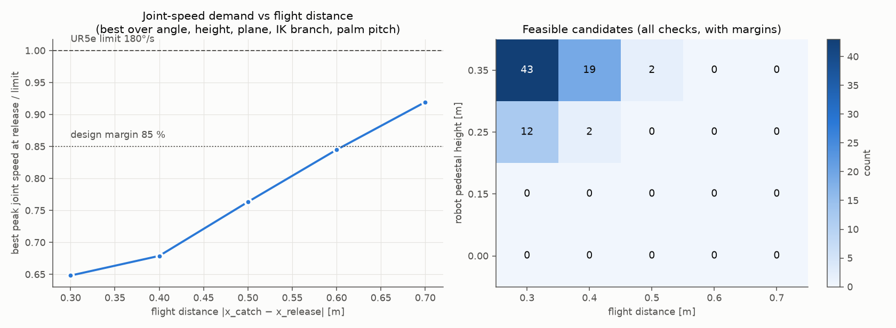
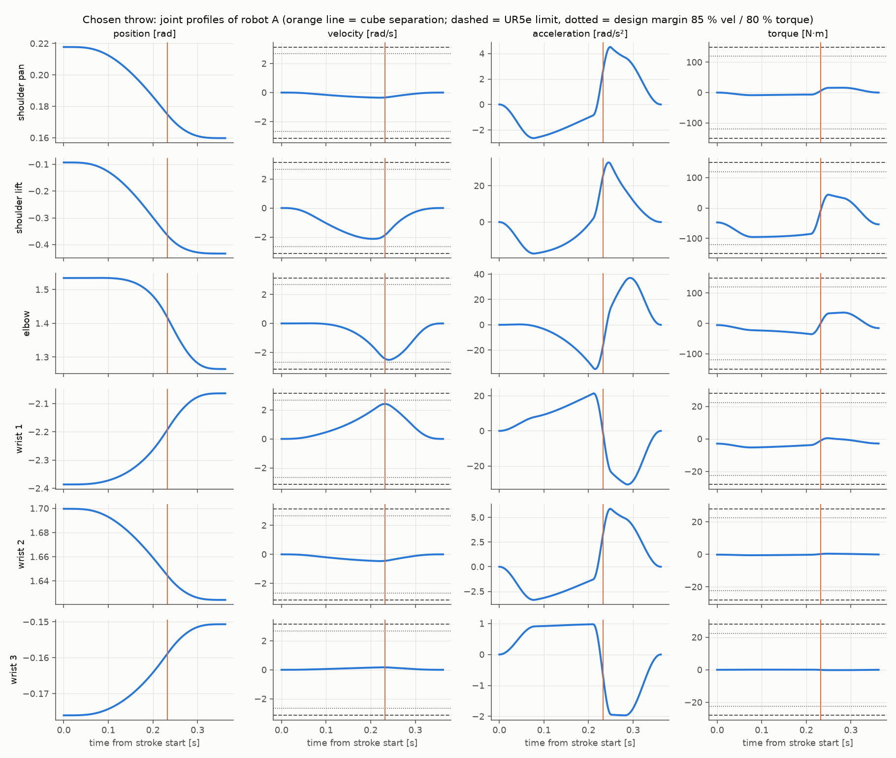
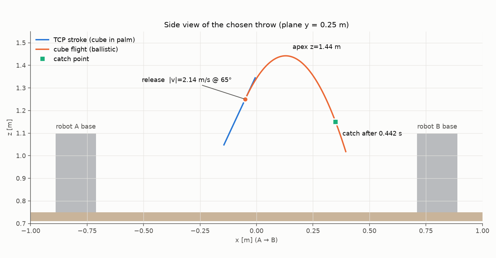

# M1 — Throw feasibility study

Reproduce: `env -u PYTHONPATH .venv/bin/python tools/feasibility.py` (~15 min, 10 800 candidates) then
`tools/plot_feasibility.py`. Code: `catch_ballistics` (projectile, release and intercept solvers),
`catch_kinematics` (UR5e DH FK / Jacobian / closed-form IK, verified against the `ur_description` URDF),
`catch_throw` (toss profile + joint-trajectory generator).

## Limits used
| | Value | Source |
|---|---|---|
| Position | ±2π on all joints, elbow ±π | `ur_description/config/ur5e/joint_limits.yaml` (UR5e manual) |
| Velocity | 180 °/s = π rad/s, all joints | same |
| Torque | 150 / 150 / 150 / 28 / 28 / 28 N·m | same ("max joint torques" UR article) |
| Acceleration | **not published**. UR's own MoveIt config: "the robot does not inherently have any limits on joint accelerations (only on torques)". | `ur_moveit_config/config/joint_limits.yaml` |

So acceleration is bounded through torque: MuJoCo inverse dynamics (`mj_inverse`) on the Menagerie UR5e
inertias + armature + 2F-85 + a 60 g cube at the TCP, gravity included. Design margins required for
"feasible": joint speed ≤ 85 % of limit, torque ≤ 80 %, position ≥ 0.15 rad from limits, cube centre
≥ 6 cm above the table, robot collision geoms ≥ 2 cm from table / pallets / pedestals, IK branch continuous,
and B must be able to hold the catch pose (TCP at the catch point, palm normal against the incoming
velocity) with ≥ 0.15 rad position margin. Peak joint accelerations are reported too.

## The toss model
The TCP (cube centre, 0.1408 m from `tool0`) moves on a straight line along the release direction n,
the palm normal equals n at release. Scalar acceleration a(t) along n: cosine ramp → constant A →
cosine ramp to −D → constant −D → ramp to 0 (`catch_throw/profile.py`). The palm pushes the cube with
N = m(a + g·n_z), so the cube separates exactly when a(t) < −g·n_z; the profile is solved so the speed at
that instant equals |v_release|. The palm may pitch about the axis normal to the throw plane at κ rad
per metre of stroke (κ = 0 is constant orientation); the cube then leaves with spin κ·|v|.

## Ballistics check of the brief's numbers
Release x = −0.35, catch x = +0.35, level, 45°: |v| = √(0.7 g) = **2.62 m/s**, flight **0.378 s**, apex
**0.175 m** above release (brief: ~2.5 m/s, ~0.4 s, ~0.15 m — close). Unit tests compare the closed
forms with numerical integration (`catch_ballistics/test`).

## Result: the brief's geometry is infeasible; 0.3–0.5 m flights are feasible on 0.35 m pedestals

* At the brief's geometry (release 0.45 m in front of A's base, 0.7 m flight) a constant-orientation
  straight stroke needs up to **2.7× the 180 °/s limit** (wrist 1 must cancel shoulder+elbow rotation,
  and the TCP is only ~0.45 m from the shoulder).
* Optimising IK branch, palm pitch rate κ, launch angle (45–75°), release height, release/catch x and a
  lateral throw plane (y = 0.13 / 0.25 / 0.35, so shoulder pan contributes), the **best achievable peak
  joint speed at the release instant** is 0.65 (0.3 m flight), 0.68 (0.4), 0.76 (0.5), 0.84 (0.6),
  **0.92 (0.7 m)** of the limit — a 0.7 m flight never fits the 85 % margin; 0.6 m passes at the release
  instant but the stroke peaks at 0.91.
* The fast releases sit near shoulder height; with the robots directly on the table the stroke start
  (0.2–0.3 m below release for a steep throw) or the wrist hits the table. Raising both bases on
  **0.35 m box pedestals** (still on the table) fixes that: 128 feasible candidates at 0.35 m, 47 at 0.25 m,
  6 at 0.15 m, none at 0.

Counts: 10 800 candidates, 181 feasible. Main rejection reasons: release joint speed (9 704), stroke joint
speed (408), arm/table clearance (~150), IK failures (20). Full data: `docs/feasibility/summary.json`.

## Chosen geometry (now in `scene.yaml` and `catch_throw/config/throw.yaml`)

| | Value |
|---|---|
| Robot pedestals | 0.35 m (bases at z = 1.10 m), bases still at x = ∓0.80, y = 0 |
| Throw plane | y = +0.25 m (pallets are at y = −0.28, clear of the flight path) |
| Release point (TCP = cube centre) | (−0.05, 0.25, 1.25) — 0.75 m in front of A's base, 0.15 m above it |
| Catch point | (+0.35, 0.25, 1.15) — the brief's catch x, 0.45 m in front of B |
| Launch angle / speed | 65° / **2.14 m/s** (v = [0.905, 0, 1.941]) |
| Flight time / apex | **0.442 s** / z = 1.44 m (0.19 m above release) |
| Cube spin at release | −1.93 rad/s about +y (≈ 49° of pitch tumble in flight; the pads squeeze the ±y faces, which this rotation does not change) |
| Stroke | 0.327 m in 0.362 s; separation at t = 0.232 s; A = 12 m/s², D = 25 m/s² |
| **Peak joint speed / limit** | pan 0.11, lift 0.68, elbow **0.80**, wrist1 0.77, wrist2 0.15, wrist3 0.05 |
| **Peak torque / limit** | pan 0.11, lift **0.64**, elbow 0.24, wrist1 0.19, wrist2 0.02, wrist3 0.01 |
| Peak joint acceleration | 4.5 / 32.8 / 37.1 / 30.5 / 5.9 / 2.0 rad/s² |
| Position margin (min) | 1.61 rad (elbow) |
| Min clearance arm ↔ table/pallets/pedestals | 4.8 cm |
| B catch pose position margin | 1.78 rad |

Why this one among the 181: it keeps the brief's catch point, has the lowest spin of the 0.4 m options
(spin is the cost of beating the velocity limit), the steepest descent (65°: B's palm faces up within 25°
of vertical, so gravity helps keep the cube in the cup), and ≥ 15 % / 36 % velocity / torque margin. The
longest feasible flight (0.5 m, rank 0) needs spin −2.7 rad/s and a 55° throw; it is the fallback if a
longer flight is wanted.

## Decisions / deviations from the brief (please review)
1. **Robots on 0.35 m pedestals** and a **0.4 m flight** (release x = −0.05, catch x = +0.35) instead of
   0.7 m with bases on the table. The 0.7 m flight cannot stay within the 180 °/s limit with a 15 % margin
   for any geometry in the sweep. Limits were not raised.
2. The palm pitches during the stroke (κ = −0.9 rad/m) so shoulder, elbow and wrist 1 add up; the
   price is 1.9 rad/s of cube spin about the axis the fingers close along.
3. A primitive **palm insert** (box, top 110 mm above the robotiq base) so a cube resting on the palm sits
   between the pads (the bare Menagerie palm hull is at 90 mm, pads start at 112–123 mm). It collides only
   with cubes. It carries the palm touch sensor for M5.

## Known limitations
* The study assumes perfect joint tracking; M4 measures the real release state through the JTC.
* Arm self-collision is not checked (the stroke only moves lift/elbow/wrist1 by ≤ 0.35 rad from a
  folded-free pose; MoveIt checks the approach to the start pose).
* Drag is ignored (MuJoCo default medium is vacuum; for a 40 mm, 60 g cube at 2 m/s drag would be ~1 % of
  weight).
