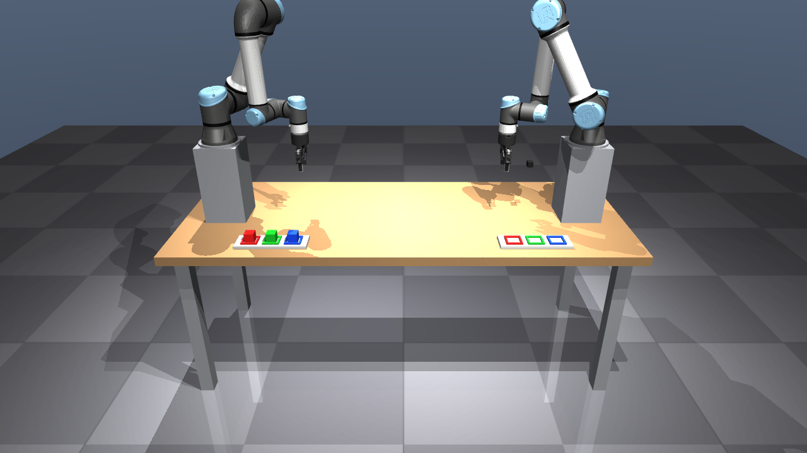

# M2 — Scene, bringup, contacts

## One source of truth for two models
`catch_description/config/scene.yaml` (+ `physics.yaml`, `poses.yaml`) drives both
* the **MJCF** (`scripts/build_mjcf.py`, MjSpec composition of pinned Menagerie UR5e + 2F-85, offline in the
  venv; output committed as `mjcf/scene.xml` + `mjcf/assets/`), and
* the **URDF** (`urdf/scene.urdf.xacro`, `ur_description` + `robotiq_description` macros, read by MoveIt / RSP).

World (primitives only for everything that is not a robot): wooden table 2.0 × 0.8 m (top z = 0.75) on four
steel legs, checker floor, gradient skybox, three lights; two **0.35 m steel pedestals** (M1) carrying the
UR5e bases at x = ∓0.8; two pallets (y = −0.28) with R/G/B slot borders (52 mm inner, 90 mm pitch); three
40 mm / 60 g cubes in A's slots; cameras `overhead_a`, `overhead_b` (640×480, 0.7 m above the pallets),
`side` (looking along +y at the flight path), `demo` (video) and B's wrist camera (`b_robotiq_wrist_cam`,
320×240, on a bracket on the gripper looking at the palm). 

## FK agreement (integration test, `test/test_fk_agreement.py`)
50 random configurations per arm, frames tool0, TCP and gripper base: **worst error 1e-9 mm and 4e-6°**
(budget 1 mm / 1°). This needed three fixes, all caught by the test or by the FK comparison that preceded it:
Menagerie's rounded UR5e offsets patched to the exact DH values; Menagerie's UR5e model frame is rotated by π
about z w.r.t. `ur_description`'s `base_link` (mount frame compensates); the MJCF TCP site was created in
the gripper-base frame (rotated −90° from tool0) and is now aligned with tool0. A second test
(`test_mjcf_up_to_date.py`) fails if `scene.xml` is stale w.r.t. the YAML.

## Bringup
`ros2 launch catch_bringup bringup.launch.py` → MuJoCo window + ros2_control (2 effort JTCs, 2 gripper
action controllers, JSB) + move_group + RViz (MotionPlanning, TF incl. ground-truth cubes, camera image).
The launch forces PRIME offload; `gpu_check` confirmed `ros2_control_node` (729 MiB) and `rviz2` on the RTX
5060 (`nvidia-smi`). RTF stayed at 1.000 (rtf_monitor) through all M2 tests.

* Arms hold the ros2_control initial pose to 1e-5 rad at startup (MuJoCo gravity compensation through the
  actuators — fixes the sagging seen in the M0 spike).
* `ros2 run catch_tasks jog_test`: **12/12** — both arms: joint goal (reached to ≤ 1.7e-3 rad), pose goal,
  back home via MoveIt; both grippers close (0.68) and open (0.02) via the MoveIt gripper groups.
* MoveIt: SRDF generated headless by `tools/gen_srdf.py` (Setup-Assistant algorithm with FCL + our URDF FK,
  20 000 samples): 741 link pairs, 543 disabled (34 adjacent, 4 default, 505 never), 198 checked.

## Contacts and the static grasp test
Physics (`physics.yaml`): 1 ms step, implicitfast, elliptic cones, impratio 10; cube μ = 0.9, condim 4,
solref (0.004, 1), solimp (0.95, 0.99, 0.001); Menagerie 2F-85 pads (priority 1, condim 3) with μ = 1.0.
Grip: Menagerie's 5-unit actuator force limit gives **~46 N normal force per finger** on a 40 mm cube.

Static grasp test (`ros2 run catch_tasks grasp_test --robot a|b`): cube spawned on the palm with the gripper
facing up, gripper closes, then the arm follows a 10 s six-joint sinusoid through the JTC (gripper tilting
up to ~45° and rolling ±1.5 rad, peak joint speed 2.1 rad/s measured). Result:

| | Arm A | Arm B | Offline (exact sync) |
|---|---|---|---|
| max cube displacement in the TCP frame | **1.61 mm** | **1.46 mm** | 1.27 mm |
| final displacement | 1.22 mm | 1.22 mm | — |
| raw (no timestamp alignment) | 2.57 mm | 2.50 mm | — |

Pass (< 2 mm). Notes: the displacement does not depend on friction (μ 0.6–1.2 identical) — the cube does not
slide; it is the soft-contact compliance as gravity rotates in the gripper frame (2 ms step: 0.82 mm).
`/joint_states` lags the free-joint ground truth by a constant **2.5 ms** (both arms, estimated as the offset
minimising apparent slip); without alignment v·Δt adds ~1 mm of fake slip. This delay matters for M5.

## Decisions / changes
* **Palm insert narrowed to 40 × 12 mm** and the gripper is never commanded beyond **0.70** (of 0.8): the
  2F-85 spring links sweep through the palm area when closing on nothing; with this insert they stay > 1 mm
  away up to 0.71 (checked in MuJoCo), and MoveIt's "closed" state is 0.70.
* `palm_up` pose chosen by IK branch search for ≥ 96 mm gripper↔arm clearance (the first choice put the
  cube against the forearm under motion — caught by the test's contact check).
* The deprecated `position_controllers/GripperActionController` is used (MoveIt's simple controller manager
  speaks GripperCommand); `allow_stalling: true` so a grasp returns success.
* No `moveit_py` binary: a small rclpy client (`catch_tasks/moveit_client.py`) wraps MoveGroup,
  compute_cartesian_path and ExecuteTrajectory.
