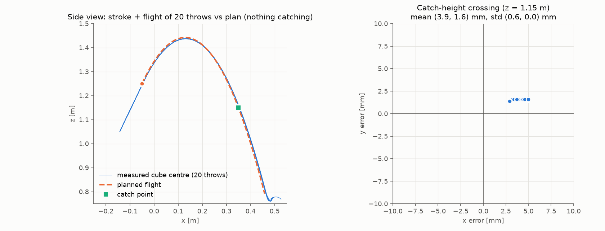

# M4 — The throw

## How it works
1. **Load + seat**: A picks the cube from its pallet (M3), goes palm-up (`palm_up`), opens to a 55 mm gap so the
   cube drops onto the palm insert, re-grips. (For the 20-throw statistics the cube is spawned straight onto the
   palm instead; the 3 full-chain throws below show both give the same release.)
2. **Pre-throw**: MoveIt joint goal to the stroke start (`q_start` of the plan; the held cube is attached in the
   planning scene).
3. **Throw** (`catch_throw/throw_node`, action `/throw`): the M1 plan (straight-line toss, palm normal = release
   direction at release, palm pitch −0.9 rad/m) is sent directly to `arm_a_controller` (JTC, effort interface)
   as 92 points at 4 ms with positions, velocities, accelerations **and feed-forward torques**, with a start
   stamp 0.5 s in the future. The ThrowPlan (release pose, velocity, spin, release time in sim time, cube id) is
   published latched on `/throw_plan` before the stroke starts → B gets it ≥ 0.73 s before release.
4. **Release**: at t = 0.12 s (during the 12 m/s² acceleration) the gripper is loosened to 0.30 (55 mm gap): the
   cube is free but pressed onto the palm and flanked by the fingers. It separates when the palm's deceleration
   along its normal exceeds g·sin65° (planned t = 0.232 s). The fingers never "throw".

## Torque feed-forward (the change that made it accurate)
With the JTC's PD alone the arm lagged during the acceleration and overshot into the deceleration (shoulder lift
+0.156 rad/s at release): release speed **+0.264 m/s (12 %)**, 2.1° steeper, cube 55 mm long at the catch height.
`tools/throw_feedforward.py` computes τ_ff = M(q)q̈ + c(q,q̇) (MuJoCo `mj_inverse`, Menagerie inertias +
gripper + cube, gravity excluded because the sim compensates it) for the plan samples and writes
`catch_throw/config/throw_ff.yaml` with a hash of the trajectory inputs; the node refuses a stale table. The JTC
adds the interpolated `effort` of each point to its PD output (verified in the 4.42.1 source). Peak feed-forward
96 N·m (shoulder lift).

## Gripper loosen time (3 throws each)
| t_loosen | speed error | catch-height crossing x | spin |
|---|---|---|---|
| 0.05 s | +8.6 mm/s | 4.4 mm | −1.88 rad/s (y) |
| **0.12 s (chosen)** | **+1.2 mm/s** | **3.5 mm** | −1.88 (y) |
| 0.18 s | +13 mm/s | 5.0 mm | −0.29 about x appears (fingers still touching) |
| 0.21 s | −69 mm/s | −13 mm | gripper still opening at separation |

## 20 throws (`ros2 run catch_tasks throw_eval --throws 20`, nothing catching, B stowed)
Ground truth: MuJoCo free-joint state at 200 Hz. Release state = least-squares ballistic fit (known g) to the
free flight, evaluated at the planned release time. Raw data: `docs/m4/throws_20.json`.

| | Commanded | Actual (mean ± std, n = 20, 20/20 ok) |
|---|---|---|
| release velocity [m/s] | (0.9052, 0, 1.9412), \|v\| 2.1419 | (0.9171, 0.0032, 1.9430) ± (0.0009, 0.0001, 0.0026), \|v\| 2.1485 ± 0.0025 |
| speed error | — | **+6.6 ± 2.5 mm/s** (+0.31 %) |
| direction error | — | **0.28 ± 0.03°** |
| release position at the planned time [mm] | (−50, 250, 1250) | error (+0.4, +0.2, −5.2) ± (0.16, 0.02, 0.32) |
| separation time vs planned | t = 0.232 s | +11 ± 16 ms (limited by GT stamp jitter, see below) |
| spin [rad/s] | (0, −1.928, 0) | (−0.002, −1.890, 0.001) ± 0.007 |
| joint-speed error at release [rad/s] | — | lift −0.041, elbow +0.066, wrist1 −0.018, others < 0.005 |
| **crossing of the catch height** (z = 1.15) vs catch point | (0.35, 0.25) | error **(+3.9, +1.6) ± (0.6, 0.05) mm** |
| **table landing** vs ballistic prediction from the plan | (0.463, 0.250) | error **(+9.6, +2.0) ± (2.1, 0.05) mm** |

Full chain (pick from pallet by detection → re-seat → throw), 3 throws: speed error +0.8 / +5.1 / +0.1 mm/s,
catch-height crossing x error −0.1 / +1.8 / −2.6 mm.

Notes
* The table landing error is larger than the catch-height error because the cube tumbles (−1.9 rad/s) and a
  corner touches the table before the centre reaches its resting height; the catch height is what matters for B.
* The free-joint ground truth topic has ~1–2 ms stamp jitter (2–4 mm residual at 2 m/s around an exact parabola,
  independent of where the fit window starts). The velocity fit averages it out (< 1.2 mm/s change across fit
  windows); the separation-time estimate cannot.
* The −5 mm release-height offset: the seated cube centre sits below the nominal TCP (soft contact under the
  ~13 m/s² palm load + insert seating). It is constant and is in the published release state B uses.

## Interfaces for M5
`/throw_plan` (`catch_interfaces/ThrowPlan`, transient-local): release position/velocity/spin, `release_time`,
`stroke_start_time`, nominal `flight_time` and `catch_point`. Published when the throw is committed (0.5 s lead
+ 0.232 s to release).
