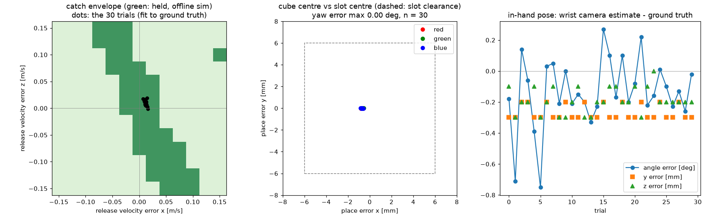

# M5 — The catch

## How it works
1. **Pre-position from the throw plan.** `catch_catcher/catcher` (action `/catch`) gets the throw-plan preview
   (`/throw/preview`), predicts the flight (`catch_ballistics`) and takes the intercept at the plan's catch point
   on the descending arc: (0.35, 0.25, 1.15), cube velocity (0.905, 0, −2.395) m/s, 0.442 s after release. The
   **cup pose**: tool z = −v (palm faces the cube), fingers (closing axis) along world y, fully open, TCP at the
   intercept. Of the 8 IK branches, 4 are elbow-up; the chosen one is the elbow-up branch closest to B's home
   (`[-0.907, -0.155, 1.971, 3.126, 1.289, -2.268]`): 103 mm from table/pallet/pedestal, **58 mm** between the
   arm (gripper excluded) and the cube's path up to 25 ms before arrival, joint margin 1.17 rad. B moves there
   with MoveIt (collision checking on) and reports "ready" before A commits the throw (≥ 0.73 s before release).
2. **Contact trigger.** B's palm insert is its own welded body carrying a MuJoCo force sensor, exported through
   ros2_control (`b_palm_ft_broadcaster`, 500 Hz). The catcher arms on the live `/throw_plan`, takes the pre-throw
   baseline, and sends the gripper close command from the force callback when |F − F₀| > 8 N. The close is never
   timed (the predicted-time trigger exists only as a baseline). **No weld/equality constraint involves a cube**
   (`test_no_cube_constraints.py`); the cube is held by contact and friction only.
3. **Held?** The node judges "held" from the knuckle angle after 0.6 s (no ground truth). The evaluation
   (`catch_eval`) uses ground truth 1 s later: cube centre < 20 mm from B's TCP, at rest, **and** fingers closed on
   it (a cube lying in the open cup does not count).
4. **Color** from B's wrist camera (`/perception/get_color`), never from A's label.
5. **In-hand pose** (`/perception/in_hand_pose`): the wrist camera sits on the closing axis, outside the finger,
   and sees the near cube face around the finger. Face pixels are back-projected onto the face plane
   (x_tcp = +20 mm); points outside the physically possible face region (below the palm surface, > 45 mm to the
   side) are dropped — rays from a same-colored slot border *behind* the hand land there; a 40 mm square
   is fitted robustly to the mask boundary, then refined on the two lateral edges and the fingertip-side edge
   only (the palm-side edge is hidden by the knuckle) → rotation about the closing axis + offset (y, z).
6. **Corrected place** (`skills.place_tcp_pose`): of the 24 orientations of the cube, take the one that makes
   the cube square to the slot with the least tool tilt; the TCP pose follows from the estimated in-hand
   transform; the release height is the lowest one at which the cube clears the pallet by 4 mm and every
   fingertip clears the slot borders by 2 mm; B keeps its closing axis (and so its wrist camera) along world y.
   B carries the cube via its home pose, then places top-down.

## "The cube arrives spun ~48° about the closing axis"
True in the world frame: the cube spins at −1.89 rad/s about y for 0.442 s = **48.8°**. But the cup is tilted
by almost the same amount: A's palm normal at release is 65° above horizontal, B's cup normal (−v at the
intercept) is 111°, and the M1 palm-pitch design (κ = −0.9 rad/m) made the spin match it. Relative to B's palm
the cube arrives at **−2.8°** (offline trace, `tools/catch_study.py`), and the palm squares it on impact:
ground-truth in-hand rotation over the 30 catches is **−0.09 ± 0.60° (max 3.1°)**. In the clean demo the in-hand
estimate and the corrected place therefore mostly correct the in-hand *offset* (−2.0 ± 1.1 mm along tool y); the
rotation case is tested separately below with deliberately off-centre catches (up to 18° in the hand).

## Results: 30 throws (10 per color), contact trigger, corrected place
`ros2 run catch_tasks catch_eval --throws 30 --out docs/m5/catch_30.json` (raw: `docs/m5/catch_30.json`,
recordings `log/m5/force/`; batch: `tools/run_m5.sh`). RTF 1.000 except one 30 s window at 0.83 (offline video
rendering ran at the same time). This is the final of four full runs: the first had one missed trigger and two
failed place motions (fixed, see below); the second and third were repeated after evaluation/code fixes (the
ground-truth in-hand angle assumed the cube's y axis lies along tool y, but the cube sits in the hand rotated 90°
about tool z; then B's place yaw was constrained, see the regression section) — every run caught 30/30 once the
trigger fix was in.

| | Result |
|---|---|
| **catch success (ground truth)** | **30 / 30** (red 10/10, green 10/10, blue 10/10) |
| trigger time − predicted arrival | −2.7 ± 0.7 ms (max 4.3 ms) — the contact, not a clock |
| peak palm force | 59 ± 14 N (max 84 N) |
| color from the wrist camera | 30 / 30 correct |
| in-hand pose, ground truth | rotation −0.09 ± 0.60° (max 3.1°); offset (0.1, −2.0 ± 1.1, 4.0 ± 0.2) mm |
| in-hand estimate − ground truth | angle −0.14 ± 0.22° (max 0.75°); y −0.27 ± 0.05 mm, z −0.19 ± 0.08 mm (max 0.3 mm) |
| **placed in the slot** | **30 / 30** |
| **place error** (cube centre − slot centre) | x −0.70 ± 0.07 mm (max 0.83), y −0.01 ± 0.01 mm |
| **place yaw error** | **0.00° (max 0.00°)**, tilt 0.00° (cube flat) |
| complete (catch + color + place) | 30 / 30 |



Left: offline catch envelope (held / not held over release-velocity errors, contact trigger with 6 ms latency)
with the 30 trials' release-velocity errors fitted to the ground truth: (+11.9, +3.1, +9.3) ± (2.0, 0.4, 4.7)
mm/s. B tolerates large errors *along* the flight path (they only shift the arrival time) but only about
±25–50 mm/s *across* it (≈ ±15–20 mm at the palm, the half-width of the 40 mm palm insert). The clean demo sits
inside the band, ~25 mm/s from its edge in x.

### Baselines
| | n | catches | notes |
|---|---|---|---|
| contact trigger (above) | 30 | 30 | close command −2.7 ± 0.7 ms vs predicted arrival |
| **predicted-time trigger** (`--trigger time`, offset 0) | 30 | 30 | close command **+6.2 ± 11.8 ms, up to +49.7 ms** vs predicted arrival (Python sleep on the sim clock) |
| place **without** in-hand correction (`--no-correction`) | 15 | 15 | place error x **+1.67 ± 1.19 mm (max 3.39)**, yaw 0.00°, 15/15 in slot |

The time trigger catches too in this clean, deterministic sim — the cup holds the cube on the palm after the
impact long enough (offline: closing 20 ms early to 40 ms late all hold). Its commanded instant, however,
scatters by tens of ms (the same Python/sim-clock jitter that delayed A's grip loosen, see below), so it would
not survive a faster or less forgiving catch. The correction removes the in-hand offset from the place error
(3.39 → 0.83 mm worst case).

### Off-centre catches: in-hand rotation, and what the correction buys
In the clean demo the cube ends up square in the hand, so the rotation part of the correction is barely used.
To exercise it, the catch goal has an experiment-only knob (`cup_offset`, default 0) that shifts B's cup pose
across the flight path: the cube then hits the palm off-centre and is gripped rotated and off-centre
(`tools/run_m5.sh cup`; raw `docs/m5/cup_*.json`). 6 throws per row; ground truth taken when the in-hand estimate
is made.

| cup offset | place | caught | in-hand rotation / offset (ground truth) | estimate error | in slot | place error (cube centre) | cube resting tilt |
|---|---|---|---|---|---|---|---|
| +15 mm | **corrected** | 4/6 | −0.1 … +1.4° / −17 mm | ≤ 0.60°, ≤ 0.2 mm | **4/4** | x −0.4 … −0.6 mm | 0.0° |
| +15 mm | uncorrected | 3/6 | −0.6 … +1.0° / −12 … −14 mm | ≤ 0.69° | **0/3** | x +8 … +11 mm, z +3 mm | 10–11° (on the border) |
| −10 mm | **corrected** | 5/6 | **−6.6 … −18.3°** / +11 … +17 mm | ≤ 0.29°, ≤ 0.7 mm | **5/5** | x −0.8 … −1.0 mm | 0.0° |
| −10 mm | uncorrected | 6/6 | −4.0 … −13.4° / +9 … +13 mm | ≤ 0.36° | **0/6** | x −8 … −14 mm, z +3 mm | 10–12° (on the border) |

* The correction is what makes these places work: **9/9 in the slot with it, 0/9 without** — uncorrected, the
  cube comes down 8–14 mm off-centre and ends up resting tilted on a slot border.
* The wrist-camera estimate stays within 0.7° and 0.7 mm up to 18° of in-hand rotation.
* The offsets are at the edge of the catch envelope: 7/12 caught at +15 mm, 11/12 at −10 mm (the misses bounce
  out before the fingers close). This is a deliberate perturbation, not the demo configuration.
* Two evaluation bugs were found here: the ground-truth angle assumed the cube's y axis lies along tool y (the
  cube sits in the hand rotated 90° about tool z, so the "ground truth" was noise while the estimate was right),
  and a red slot border behind the hand leaked into the face fit (fixed with the physical gate on the face plane).


## Failure modes found (and fixed) on the way — with clips
| Clip | What happened | Fix |
|---|---|---|
| [`media/m5_fail_late_release.mp4`](media/m5_fail_late_release.mp4) | The throw node loosened A's grip with a Python sleep on the sim clock. Under the load of the catch evaluation the loosen came **97 ms late** (0.217 s instead of 0.120 s): the fingers still held the cube during the deceleration, release 107 mm/s slow, the cube arrived 20 mm off-centre, slid off the palm insert before the pads closed. (Clip: the same failure re-created with the opt-in fault injection, loosen at 0.26 s.) | Gripper A runs on a **JointTrajectoryController**; the loosen is a time-stamped trajectory executed by the 500 Hz control loop in sim time. 20 throws after the change: speed error +7.3 ± 1.6 mm/s (M4: +6.6 ± 2.5). Loosening *before* the stroke was tried and rejected: the cube slid off the palm in 3 of 6 throws. |
| [`media/m5_fail_missed_trigger.mp4`](media/m5_fail_missed_trigger.mp4) | First 30-throw run, trial 21: the cube hit the palm (the recorder saw an 82 N spike) but the catcher saw at most 3.9 N — its rclpy executor (1 kHz /clock + 500 Hz joint states) lagged and the 50-deep queue dropped the 1–2 sample spike. The fingers never closed; the cube lay in the open cup. | Wrench queue 1000 deep (2 s), subscribed at goal start (DDS discovery) with a data-flow check before "ready"; held check requires closed fingers. |
| — | 2 of 30 places failed in the first run: the path from the cup pose to the place pose clipped the (deliberately oversized) wrist-camera housing collision box against the upper arm between OMPL samples (MoveIt `ValidateSolution`). | Carry via B's home pose, retry the place motion once. |
| — | Regression after M5 (pick/place test, B places): the descent into the red and green slots stopped at 95 %: MoveIt saw the wrist-camera housing collision box 2.3 mm inside the pallet when the place yaw put B's closing axis (and camera) along world x, over the neighbouring slots. | Housing collision box = the MJCF housing + 1 mm; B's places keep the closing axis along world y (camera beside the pallet). Pick/place test 6/6 again. |
| [`media/m5_catch_ok.mp4`](media/m5_catch_ok.mp4) | A normal catch (0.25x). | |

Clips are replays of the recorded sim state (`tools/render_replay.py`: arms and cubes pinned to the recorded
joint states / ground truth, gripper linkage re-simulated from the recorded knuckle angle).
Re-rendered in v1.0.1 with the wrist-camera bracket (recordings in `log/`, gitignored):

```bash
R="env -u PYTHONPATH .venv/bin/python tools/render_replay.py"
$R log/m5/force/trial_07.npz --out docs/media/m5_catch_ok.mp4 --view catch \
   --label "M5 trial 7 (green): contact-triggered cup catch"
$R log/m5_run1/rec/force/trial_21.npz --out docs/media/m5_fail_missed_trigger.mp4 --view catch \
   --label "M5 run 1, trial 21: palm-force spike dropped by the catcher -> fingers never close"
$R log/m6_dev/fault.npz --out docs/media/m5_fail_late_release.mp4 --view throw --window 18.7,20.6 \
   --label "injected fault: grip loosened late (0.26 s) -> slow release, cube misses B's palm"
```

## Other changes in M5
* URDF: `b_wrist_cam_optical` (+ a housing collision box); FK test extended to the camera (0.000 mm / 0.00001°).
  The static camera-TF publisher no longer publishes a mismatching `b_wrist_optical`.
* Perception nodes use a `/tf_static`-only TF buffer: a full `TransformListener` made the in-hand service take
  11 s (500 Hz `/tf` in rclpy).
* Recorder / catcher subscribe to 500 Hz topics only while needed (the evaluation process was at 100 % CPU and a
  trial took 5 min).
* Pre-M5 review items: the throw feed-forward table was stale after the gripper change (regenerated; max
  difference 0.09 N·m); `MUJOCO_LOG.TXT` untracked. `apt-cache policy` still shows the Isaac
  `ros-jazzy-robotiq-description 9.0.1-0noble` and `ros-jazzy-ur-* 99.2.0-0noble` installed (the downgrade did not
  take effect); the project uses only robotiq_description's visual meshes, so nothing changed, all tests pass.

## Regression of M2–M4 after the M5 changes (gripper A on a JTC, URDF camera, place yaw)
| Test | Result | Before |
|---|---|---|
| static grasp, A (`grasp_test --robot a`, limit 2 mm) | 8 runs: 7 at 1.44–1.63 mm, **one at 2.35 mm (over the limit)** — the first run after a fresh build and sim start; the 7 later runs all ≤ 1.63 mm | 1.61 mm (M2) |
| static grasp, B | 6 runs: 1.43–1.60 mm | 1.46 mm |
| pick/place (`pickplace_test`) | B places 3/3 (0.63–0.67 mm), A pick + place 3/3 (0.09–3.84 mm) | 6/6 (M3) |
| 20 throws (`throw_eval`, `docs/m4/throws_20_m5.json`) | speed error +8.2 ± 1.8 mm/s, direction 0.26 ± 0.03°, spin −1.892 rad/s, catch-height crossing (4.2, 1.6) mm | +6.6 ± 2.5 mm/s, 0.28°, (3.9, 1.6) mm (M4) |

The static-grasp slip is measured from two separately stamped topics (joint states, free-joint ground truth) and
corrected by a fitted stamp offset; its run-to-run spread is larger than the difference between the gripper
controllers (both write the same 0.70 position command).

