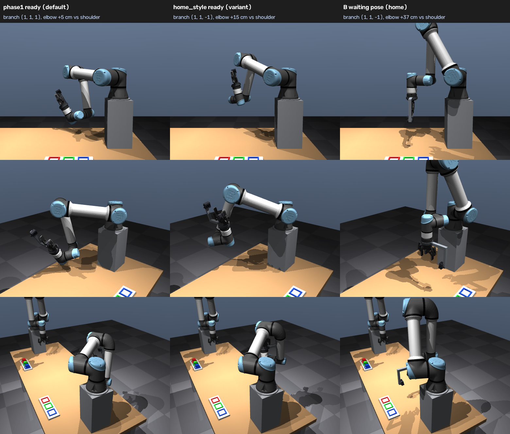

# Results

All numbers are from simulation, scored against MuJoCo's ground truth (which no decision reads). Read
[idealizations.md](idealizations.md) for what the simulation makes easier than a real cell. The full reports
behind every number, the raw per-trial data and the plots are archived in the repository history (see
[Full reports](#full-reports-archived)).

Contents: [v2 benchmark](#v2-live-benchmark) · [noise](#does-the-camera-only-catch-notice-the-release-noise) ·
[latency budget](#latency-budget) · [gripper delay probe](#gripper-delay-probe-v22) ·
[arm configuration](#arm-configuration-v23) · [full loop](#full-loop) · [v1](#v1-measured-numbers)

## v2 live benchmark

Live ROS pipeline, every cell alone (one sim at a time, real-time factor ≥ 0.996 in every 2 s window), 60 throws per
cell from A's random throw library, ground truth. One throw per cell was excluded as "setup" (A's MoveIt move to the
stroke start failed; fixed in v2.2). "Offline" = the same throws and release-noise draws in the offline MuJoCo model.
Gripper: the realistic 2F-85 model (150 mm/s, 10 ms command latency) unless the row says `fast_close` /
`fast_idealized` (NOT a 2F-85).

| cell | n | caught | rate [95 % CI] | offline, same throws | outcomes | trigger | commit after 1st fix | re-plan rate median (p10–p90) | RTF trial median / min 2 s window | load avg 1 min median / max (24 cores) | realised release error (speed sd, direction rms, time sd) |
|---|---|---|---|---|---|---|---|---|---|---|---|
| camera-only, pinch, noise none | 59 | 59 | **100 %** [94–100] | 100 % [94–100] | held 59 | timed 59 | 74 ms | 39 Hz (39–39) | 1.000 / 1.000 | 3.8 / 7.0 | 0.29 %, 0.28°, 0.0 ms |
| camera-only, pinch, noise low | 59 | 59 | **100 %** [94–100] | 100 % [94–100] | held 59 | timed 59 | 74 ms | 39 Hz (39–39) | 1.000 / 0.999 | 3.2 / 7.2 | 0.32 %, 0.28°, 1.0 ms |
| **camera-only, pinch, noise medium (default)** | 59 | 59 | **100 %** [94–100] | 98 % [91–100] | held 59 | timed 59 | 74 ms | 39 Hz (39–39) | 1.000 / 1.000 | 2.8 / 7.6 | 1.15 %, 0.68°, 4.9 ms |
| camera-only, pinch, noise high | 59 | 56 | **95 %** [86–98] | 100 % [94–100] | held 56, abort 2, missed intercept 1 | timed 57, none 2 | 74 ms | 39 Hz (39–39) | 1.000 / 0.999 | 3.2 / 7.3 | 2.02 %, 1.23°, 9.9 ms |
| plan-informed, pinch, noise none | 59 | 59 | **100 %** [94–100] | — | held 59 | timed 59 | before the throw (plan) | — | 1.000 / 1.000 | 3.1 / 8.1 | 0.26 %, 0.26°, 0.0 ms |
| plan-informed, pinch, noise low | 59 | 59 | **100 %** [94–100] | — | held 59 | timed 59 | before the throw (plan) | — | 1.000 / 1.000 | 2.9 / 5.7 | 0.32 %, 0.29°, 1.0 ms |
| plan-informed, pinch, noise medium | 59 | 23 | **39 %** [28–52] | — | missed intercept 25, held 23, fingertip 10, late close 1 | timed 59 | before the throw (plan) | — | 1.000 / 1.000 | 2.4 / 8.3 | 1.20 %, 0.69°, 4.9 ms |
| plan-informed, pinch, noise high | 58 | 13 | **22 %** [14–35] | — | missed intercept 38, held 13, fingertip 6, late close 1 | timed 58 | before the throw (plan) | — | 1.000 / 1.000 | 4.1 / 8.8 | 2.04 %, 1.23°, 9.6 ms |
| camera-only, pre-closed cup (square throws), medium | 58 | 52 | **90 %** [79–95] | 87 % [76–93] | held 52, late close 3, missed intercept 2, fingertip 1 | contact 56, timed 2 | 74 ms | 36 Hz (32–36) | 1.000 / 1.000 | 3.7 / 7.6 | 1.21 %, 0.67°, 4.9 ms |
| camera-only, pinch, 64 Hz cameras, medium | 59 | 57 | **97 %** [88–99] | 97 % [89–99] | held 57, abort 1, fingertip 1 | timed 58, none 1 | 85 ms | 39 Hz (39–39) | 1.000 / 1.000 | 2.9 / 5.0 | 1.09 %, 0.69°, 4.9 ms |
| camera-only, pinch, gripper latency 0 ms (B assumes 10), medium | 59 | 57 | **97 %** [88–99] | 100 % [94–100] | held 57, fingertip 2 | timed 59 | 73 ms | 39 Hz (39–39) | 1.000 / 0.999 | 2.9 / 6.4 | 1.13 %, 0.69°, 4.9 ms |
| ... latency 20 ms | 59 | 42 | **71 %** [59–81] | 67 % [54–77] | held 42, fingertip 10, late close 7 | timed 59 | 73 ms | 39 Hz (39–39) | 1.000 / 0.998 | 5.5 / 25.7 | 1.27 %, 0.69°, 4.9 ms |
| ... latency 30 ms | 59 | 38 | **64 %** [52–75] | 50 % [38–62] | held 38, late close 13, fingertip 8 | timed 59 | 74 ms | 39 Hz (38–39) | 1.000 / 0.997 | 4.9 / 33.4 | 1.33 %, 1.46°, 4.9 ms |
| B's gripper fast_close (NOT a 2F-85; 10× speed, realistic force), medium | 59 | 52 | **88 %** [77–94] | 80 % [68–88] | held 52, fingertip 7 | timed 59 | 74 ms | 39 Hz (39–39) | 1.000 / 0.998 | 4.0 / 15.6 | 1.13 %, 0.69°, 4.9 ms |
| B's gripper fast_idealized (NOT a 2F-85; 10× speed, 5× force), medium | 59 | 59 | **100 %** [94–100] | 100 % [94–100] | held 59 | timed 59 | 74 ms | 39 Hz (39–39) | 1.000 / 0.996 | 5.5 / 8.7 | 1.15 %, 0.70°, 4.9 ms |

The gripper-latency rows are v2.1 (B *assumes* 10 ms); v2.2's delay probe removes that loss (below).
**Under load:** with three sims in parallel (v2.0) the camera-only cells lost up to 24 points to slower re-planning
(29 Hz instead of 39 Hz), e.g. the default 95 % [86–98] instead of 100 %.

### Does the camera-only catch notice the release noise?
Barely. Release noise none → high moves the arrival by up to 15 cm. Camera-only: 59/59, 59/59, 59/59, 56/59
(Cochran–Armitage trend z = −2.34, −1.5 points per level). Plan-informed (B pre-positions from A's published plan,
like v1): 59/59, 59/59, 23/59, 13/58 (z = −10.6, −29 points per level). Re-estimating the flight from the cameras is
what makes random, noisy throws catchable.

### Latency budget
Camera-only pinch, sim alone, medians:

| | time |
|---|---|
| release → first estimate (cube in both views, 5 consistent fixes) | 47 ms |
| render stamp → estimate published (included above) | **5 ms** (p95 6, max 10) |
| first estimate → commit (95 % intercept error ≤ 30 mm) | 73 ms (≈ 120 ms after release) |
| commit → first trajectory to `arm_b_controller` | ≈ 20 + 30 ms |
| re-plans until 40 ms before arrival | 8 (6–10) × 4.3 ms, **39 Hz** |
| timed close command → gap 40 mm | 108.7 ms (10 ms latency + 2 ms + 16 mm at 150 mm/s) + ~10 ms actuator lag |
| arrival after release | 0.29–0.49 s (median 0.41 s) |

The 2F-85 closing time (~120 ms) is the largest single item; perception is 5 ms. The tracker's intercept prediction
is within 9.7 mm (95 %) 0.20 s ahead of arrival.

### Gripper delay probe (v2.2)
Before its first catch B moves its fingers 0.04 rad in and back three times and times the response from
`/joint_states` alone (command latency + actuator lag + transport), then schedules the close so the *fingers* reach
40 mm 20 ms after the predicted arrival. The true latency is emulated inside B's command path; the probe never reads
it.

| true gripper latency | probe measured | v2.1, B assumes 10 ms | v2.2, probed |
|---|---|---|---|
| 0 ms | 11.3 ms | 57/59 = 97 % [88–99] | **59/59 = 100 % [94–100]** |
| 10 ms | 21.1 ms | 59/59 = 100 % [94–100] | **59/59 = 100 % [94–100]** |
| 20 ms | 31.1 ms | 42/59 = 71 % [59–81] | **59/59 = 100 % [94–100]** |
| 30 ms | 41.3 ms | 38/59 = 64 % [52–75] | **59/59 = 100 % [94–100]** |

v2.2 also fixed trajectories rejected by the controller (3–4 % of B's re-plans had a duplicate final point time; 0
after) and skips the 13 of 241 pinch / 9 of 121 cup library throws whose stroke start MoveIt's meshes reject.
Verification of all three changes (default configuration, 60 throws): 59/60 = 98 % [91–100], every throw valid, 0
rejected trajectories; the one miss is a fingertip grasp.

## Arm configuration (v2.3)

B waits for the throw in the "Phase 1" ready pose: upper arm nearly horizontal, forearm hanging, elbow only 4.7 cm
above the shoulder. That looks elbow-down, so v2.3 searched for a natural elbow-up pose on the same IK branch as B's
home (no wrist flip on the way), fixed the planner to that branch and benchmarked it on the same throws
(each cell alone, 60 throws, medium noise, camera-only pinch):

| | **Phase 1 pose (default)** | elbow-up, 60° approach | elbow-up, 55° approach |
|---|---|---|---|
| ready TCP | (0.30, 0.25, 1.10) | (0.225, 0.25, 1.325) | (0.225, 0.20, 1.30) |
| elbow above shoulder | 4.7 cm | 15.5 cm | 15.5 cm |
| **catch rate [95 % CI]** | **59/59 = 100 % [94–100]** | 30/59 = 51 % [38–63] | 33/59 = 56 % [43–68] |
| failures | — | 17 abort, 10 missed, 2 fingertip | 12 abort, 7 missed, 7 fingertip |
| A's library throws feasible for the planner | 100 % | 80 % | 89 % |
| peak torque / limit, planned (max / median) | 0.56 / 0.34 | 0.74 / 0.50 | 0.77 / 0.42 |

**Why the natural pose loses:** A's throws arrive low (median intercept z ≈ 1.1 m). Waiting 20–23 cm higher, B
cannot get down in time within its speed limit (aborts), or meets the cube off-axis so it stops at the fingertips
(missed). The elbow-up poses reach *more* space, but the wrong space. The Phase 1 pose stays the default; the
elbow-up poses are `reactive.yaml` variants (`CATCH_READY_POSE=home_style CATCH_IK_BRANCH=fixed`). The reactive
planner never changed IK branch during a catch (0 changes in 310 recorded trials); the visible wrist flips were the
moves home ⇄ ready around it.

Also in v2.3: B waits at home and gets ready while A loads (ready 0.5–3.6 s before A's stroke start, never late),
and B's wrist camera is a 42 × 42 × 23 mm depth camera on a clamp mount (collision capsules checked against both
MuJoCo and MoveIt's meshes; optical frame unchanged).

## Full loop

`run_demo --seed N`: DETECT → PICK → LOAD → PREPOSITION → THROW + camera-only pinch catch → COLOR → IN_HAND → PLACE →
VERIFY, three cubes per run, random throws with medium release noise.

| batch | runs | caught first time | placed (ground-truth error) | VERIFY = ground truth | duration |
|---|---|---|---|---|---|
| v2.3 (B waits at home, new wrist camera) | 3 seeds | **9/9** | **9/9** (≤ 1.01 mm) | 9/9 | 77.8 / 83.6 / 78.4 s |
| v2.0 | 3 seeds | 9/9 | 9/9 (≤ 1.1 mm) | 9/9 | 86.2 / 91.9 / 85.8 s |

All 18 catches: timed pinch close, commit 64–85 ms after the first estimate, 8–12 re-plans at 38–43 Hz; B's wrist
camera named the right color 18/18; cubes held up to 25° tilted in the hand were placed square (in-hand pose
correction).

## v1 measured numbers

v1: one configured throw, B pre-positions a "cup" from A's published plan, fingers close on palm contact.

| What | Result |
|---|---|
| Throw feasibility | peak joint speed 0.80, torque 0.64 of the UR5e limits; ≥ 1.61 rad position margin; 4.8 cm clearance |
| URDF vs MJCF forward kinematics | ≤ 1e-6 mm / 1e-5° (tool0, TCP, gripper base, wrist camera); gripper collision geometry ≤ 0.84 mm |
| Static grasp slip, 10 s at up to 2.1 rad/s | A 1.44–1.63 mm in 7 of 8 runs (one 2.35 mm outlier); B 1.43–1.60 mm in 6 runs (limit 2 mm) |
| Cube detection, overhead camera | 1.7 mm mean / 4.7 mm max position, 0.4° yaw |
| Release velocity, 20 throws | speed error +8.2 ± 1.8 mm/s, direction 0.26°, spin −1.89 rad/s; catch-height crossing (4.2, 1.6) mm off the plan |
| **Catch, 30 throws (10 per color)** | **30/30**, contact trigger −2.7 ± 0.7 ms vs predicted arrival; 30/30 (placed 30/30) again with the realistic 2F-85 model: the pre-positioned cup holds the cube at rest in the palm for the 340 ms a 150 mm/s close takes |
| Color check from B's wrist camera | 30/30 |
| In-hand pose (wrist camera) vs ground truth | angle error −0.14 ± 0.22° (max 0.75°), offset ≤ 0.3 mm; off-centre catches (up to 18° in the hand): ≤ 0.7° / 0.7 mm |
| **Place error**, 30 catches | **30/30 in slot**, x −0.70 ± 0.07 mm, yaw 0.00° (without in-hand correction: +1.67 ± 1.19 mm; off-centre catches uncorrected: 0/9 in slot) |
| Full loop, 3 seeds + 1 injected fault | 4/4 runs complete, 96–99 s per run (124 s with one recovery), VERIFY = ground truth 12/12 |
| Real-time factor | 1.000 |

## Full reports (archived)

The step-by-step milestone reports, raw per-trial JSON, recordings index and intermediate plots were removed from the
working tree to keep the repository small. They are in the git history, at commit
[`fdbb13f`](https://github.com/JaisalJain/catch-me-if-you-can/tree/fdbb13f435c2b5288b07e24d6d3cec28657a7f4e/docs):

| report | covers |
|---|---|
| [m0_toolchain.md](https://github.com/JaisalJain/catch-me-if-you-can/blob/fdbb13f435c2b5288b07e24d6d3cec28657a7f4e/docs/m0_toolchain.md) | versions, GPU (PRIME / EGL), MuJoCo spike |
| [m1_feasibility.md](https://github.com/JaisalJain/catch-me-if-you-can/blob/fdbb13f435c2b5288b07e24d6d3cec28657a7f4e/docs/m1_feasibility.md) | throw feasibility, why the pedestals |
| [m2_scene_bringup.md](https://github.com/JaisalJain/catch-me-if-you-can/blob/fdbb13f435c2b5288b07e24d6d3cec28657a7f4e/docs/m2_scene_bringup.md) | scene generation, controllers, FK agreement, grasp slip |
| [m3_perception_pick_place.md](https://github.com/JaisalJain/catch-me-if-you-can/blob/fdbb13f435c2b5288b07e24d6d3cec28657a7f4e/docs/m3_perception_pick_place.md) | pallet detection, pick and place |
| [m4_throw.md](https://github.com/JaisalJain/catch-me-if-you-can/blob/fdbb13f435c2b5288b07e24d6d3cec28657a7f4e/docs/m4_throw.md) | the throw, feed-forward, release accuracy |
| [m5_catch.md](https://github.com/JaisalJain/catch-me-if-you-can/blob/fdbb13f435c2b5288b07e24d6d3cec28657a7f4e/docs/m5_catch.md) | v1 cup catch, contact trigger, in-hand pose, place |
| [m6_full_loop.md](https://github.com/JaisalJain/catch-me-if-you-can/blob/fdbb13f435c2b5288b07e24d6d3cec28657a7f4e/docs/m6_full_loop.md) | v1 state machine, recovery, demo |
| [v2_phase1_feasibility.md](https://github.com/JaisalJain/catch-me-if-you-can/blob/fdbb13f435c2b5288b07e24d6d3cec28657a7f4e/docs/v2_phase1_feasibility.md) | v2 offline study: ready pose, throw distribution, pinch vs cup |
| [v2_phase2.md](https://github.com/JaisalJain/catch-me-if-you-can/blob/fdbb13f435c2b5288b07e24d6d3cec28657a7f4e/docs/v2_phase2.md) | v2 live: tracker, reactive catch, benchmark, v2.1 / v2.2 |
| [v2_arm_config.md](https://github.com/JaisalJain/catch-me-if-you-can/blob/fdbb13f435c2b5288b07e24d6d3cec28657a7f4e/docs/v2_arm_config.md) | v2.3: ready poses, IK branch, wrist camera, RViz |
| [progress.md](https://github.com/JaisalJain/catch-me-if-you-can/blob/fdbb13f435c2b5288b07e24d6d3cec28657a7f4e/docs/progress.md) | milestone log |
