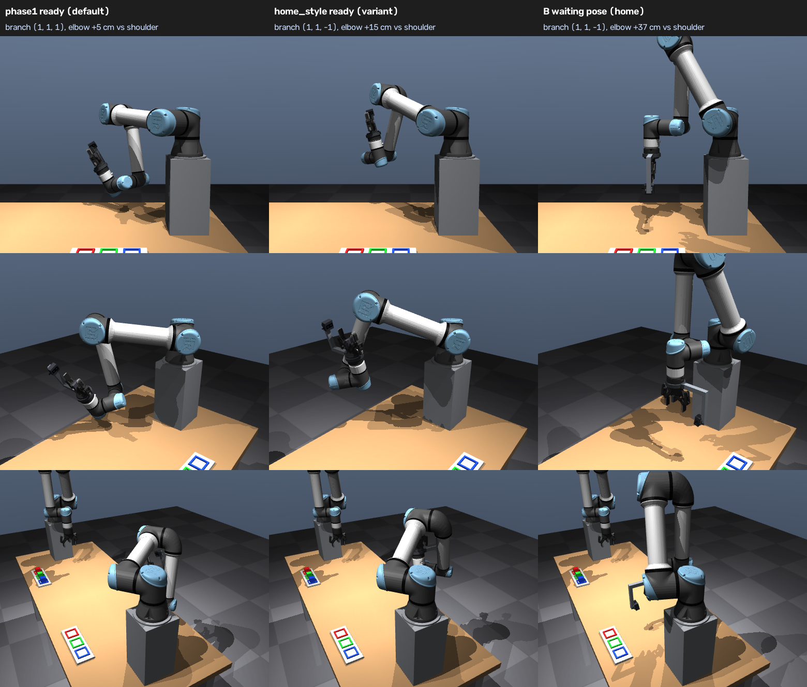
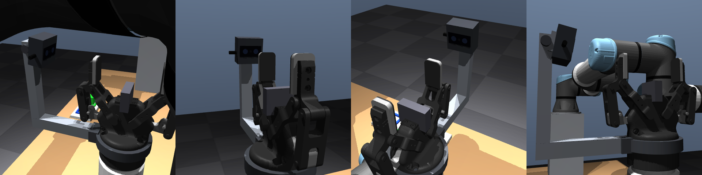

# v2.3 — B's arm configuration, wrist camera hardware, RViz

Three visual / naturalness changes after v2.2: (1) B's ready pose and IK branch, (2) a realistic wrist depth
camera instead of the thin L-bracket, (3) a clean RViz default for screenshots. Data: `docs/v2/arm_config/`.

## 1. B's arm configuration

### a. Current state (v2.2)

| | Phase 1 ready pose (v2.2 default) | B home |
|---|---|---|
| joints [rad] | [−0.880, −0.112, 1.891, −2.997, 1.175, 3.950] | [−0.391, −1.056, 2.589, −3.105, −1.571, 2.751] |
| IK branch (shoulder, elbow, wrist)¹ | (+1, +1, **+1**) | (+1, +1, **−1**) |
| elbow joint above the shoulder axis | **4.7 cm** (upper arm horizontal, forearm hanging) | 37 cm |
| TCP / approach | (0.30, 0.25, 1.10), 60° up towards A | (0.45, 0, 1.00), tool down |

¹ `catch_kinematics.UR5e.branch()`: the signs of the three choices of the closed-form IK (unit-tested against
`ik_all`). Phase 1 called this pose "elbow up" because the elbow is above the shoulder–wrist line; it is barely above
the shoulder, which is what looks elbow-down.

**Branch changes during catches** (`tools/v2_live/ik_branch_analysis.py`, every /joint_states sample of the
recorded v2.1 / v2.2 benchmark trials): **0 changes in 251 trials** (11 cells; the two fast-gripper cells recorded
all 118 trials, the others their failures). B never left (+1, +1, +1); the largest excursion of any joint from the
ready pose was 0.42 rad. The reactive planner did not switch branches.
**What does flip:** the moves *around* the catch. In the v2 demo B goes home (wrist −1) → ready (wrist +1) → place →
home: **2 wrist-singularity crossings per throw** (q5 through 0, a 2.75 rad wrist-2 swing; seed 1: 6 crossings in
3 throws). That is the big wrist turn.

### b. Elbow-up ready pose search

Required: B home's branch (+1, +1, −1) (home → ready → catch never crosses a singularity: no wrist flip), elbow joint
≥ 15 cm above the shoulder axis, joint margins ≥ 0.15 rad, |sin q5| ≥ 0.5, ≥ 5 cm from table / pedestals / pallets,
gripper facing the incoming cube (approach axis towards A, closing axis along y).

1. **Phase 1 tooling** (`tools/v2_ready_envelope.py --style home`, 2016 candidates, 360 scored on the 252-throw prior
   family): best TCP (0.35, 0.25, 1.30), approach 75°, elbow 15.3 cm, family catchable 43 % (pinch) / 36 % (cup)
   vs 58 / 54 % for the Phase 1 pose. **Live it caught nothing: 10/10 aborts** ("over limits": the library throws
   arrive low, median intercept z ≈ 1.1 m, and B would have to drop 20 cm in 0.2 s; shoulder / elbow need 1.5–2.2
   rad/s on average). The prior family covers high intercepts that A's library does not contain (the library was
   built from the throws the *Phase 1 pose* can catch).
2. **Scored on A's actual throws** (`tools/v2_live/ready_library_score.py`, 2240 candidates on B home's branch, 80
   library throws, the live planner `ReactivePlanner` with `ik_branch: fixed` from rest at a 0.15 s commit; the
   Phase 1 pose scores 100 %). Best feasible fraction by elbow height:

   | elbow above shoulder | any approach (coarse grid) | approach ≥ 60° (coarse / refined) |
   |---|---|---|
   | ≥ 0 cm | 100 % (45°, elbow 0.7 cm: a Phase 1-like pose) | 88 % / 85 % |
   | ≥ 10 cm | 95 % (30°) | 81 % / 85 % |
   | ≥ 15 cm | 91 % (30°); 89 % at 55° (refined) | 76 % / **80 %** |
   | ≥ 20 cm | 85 % (30°) | 48 % / 54 % |
   | ≥ 25 cm | 74 % (30°) | 34 % |
   | ≥ 30 cm | 43 % (30°) | 1 % |

   (refined = 2.5 cm / 5° grid around the best ≥ 15 cm, ≥ 60° pose; capsule model with the camera, see 2.)
   A 30° approach is out: the pinch needs the cube to fly *into* the palm (Phase 1: realistic pinch 87 % at 60°,
   72 % at 45°, 59 % at 30°). Two variants were benchmarked: **home_style** (60°) and **home_style_55** (55°).

### c. `ik_branch: free | fixed`

`reactive.yaml ik_branch` (env `CATCH_IK_BRANCH`): `fixed` restricts every IK goal to the ready pose's
(shoulder, elbow, wrist) branch (`UR5e.ik_closest(..., branch=)`); `free` = v2.2 (closest solution to B's state).
Ready poses are named entries (`ready_poses`, `ready_pose:` / env `CATCH_READY_POSE`); the tracker's commit reference
(`intercept_ref`) follows the selected pose's TCP. Unit tests: `test_ik_branch_fixed_keeps_the_ready_branch`,
`test_resolve_config_selects_ready_pose_and_branch`, `test_branch_matches_ik_tags`, `test_ik_closest_branch_filter`.

### d. Benchmark (each cell alone, 60 throws, medium noise, camera-only pinch, v2.2 defaults)

`tools/v2_live/bench_armconfig.sh` → `docs/v2/arm_config/bench/`; all trials recorded. Per-trial RTF ≥ 0.997.

| | **Phase 1 pose, branch free (v2.2 baseline)** | elbow-up 60°, branch fixed | elbow-up 55°, branch fixed |
|---|---|---|---|
| ready TCP / approach | (0.30, 0.25, 1.10) / 60° | (0.225, 0.25, 1.325) / 60° | (0.225, 0.20, 1.30) / 55° |
| IK branch, elbow above shoulder | (+1, +1, +1), 4.7 cm | (+1, +1, −1), 15.5 cm | (+1, +1, −1), 15.5 cm |
| **catch rate [95 % CI]** | **59/59 = 100 % [94–100]** | 30/59 = 51 % [38–63] | 33/59 = 56 % [43–68] |
| failures | — | 17 abort, 10 missed, 2 fingertip | 12 abort, 7 missed, 7 fingertip |
| envelope: grid points reachable in 0.20 / 0.25 s² | 482 / 861 | 591 / 1103 | 572 / 1147 |
| prior family catchable (pinch / cup)² | 58 / 54 % | 27 / 24 % | 27 / 26 % |
| A's library feasible (planner, 80 throws) | 100 % | 80 % | 89 % |
| peak joint speed / 180°/s, planned (max / median) | 0.85 / 0.48 | 0.85 / 0.55 | 0.85 / 0.53 |
| peak joint speed, measured /joint_states (max / median) | 0.88 / 0.46 | 0.85 / 0.51 | 0.88 / 0.48 |
| peak torque / UR5e limit, planned (max / median) | 0.56 / 0.34 | 0.74 / 0.50 | 0.77 / 0.42 |
| IK branch changes (59 recorded trials) | 0 | 0 | 0 |
| max joint excursion from ready [rad] | 0.42 | 0.40 | 0.37 |

² `tools/v2_ready_envelope.py --evaluate` (2.5 cm grid, rest-to-rest within 85 % speed / 80 % torque; family =
252 prior throws, decision at 0.20 s). The elbow-up poses reach *more* space (the arm is less folded) but it is the
wrong space: higher, while the throws arrive low.

One trial per cell was excluded (the same throw, #25: A's MoveIt move to the stroke start failed). The planner
caps (85 % speed, 80 % torque) were never exceeded; the torque reserve shrinks from 0.56 to 0.74–0.77 of the limit.

Why the elbow-up poses fail: **aborts** — the intercept is low and B, waiting 20–23 cm higher, cannot get there
within the speed limit; **missed** — the cube stopped ~43 mm in front of the palm, at the fingertips: it arrived 18°
off the approach axis (held catches: 5°).

`docs/v2/arm_config/ready_poses.png` (`tools/render_ready_compare.py`): Phase 1 ready (default), the 60° and 55°
elbow-up variants and B's waiting pose (home), from the side, the front-left and behind B.

### e. Decision

Elbow-up + fixed branch loses **44–49 points** (100 → 51 / 56 %), far more than the 3-point threshold. **The Phase 1
pose with `ik_branch: free` stays the default**; `home_style` / `home_style_55` are config variants
(`CATCH_READY_POSE=home_style CATCH_IK_BRANCH=fixed`, or `ready_pose:` / `ik_branch:` in reactive.yaml). Making an
elbow-up pose competitive would need a throw library rebuilt around its envelope (higher intercepts) — i.e. a
different task, not the same throws.

`ik_branch: fixed` with the Phase 1 pose is equivalent (the planner never left the branch in 310 recorded trials),
so it stays `free` (no behaviour change).

### f. Waiting pose between throws

The demo (`run_demo`, v2) now keeps B in a waiting pose between throws (home: elbow up, tool down;
`ready_poses.<pose>.wait_q`) and gets it ready **when A starts LOAD**: a `prepare_only` ReactiveCatch goal moves B
with a direct joint-space quintic on arm_b_controller (≤ 45 % of 180°/s, inside the planner's speed / torque limits,
capsule-checked against the environment, itself and arm A; not move_group, which serves A meanwhile), opens to the
pre-gap and probes the gripper delay. PREPOSITION waits for it and logs how early B was.

**Demo, seeds 1–3, default configuration** (`OUT=docs/v2/arm_config/demo REC=log/arm_config/demo
tools/v2_live/run_demo_v2.sh 1 2 3`): **9/9 caught first time, 9/9 placed (ground-truth error ≤ 1.01 mm), VERIFY =
ground truth 9/9** (`tools/analyze_runs.py`). B was ready 4.16 s after LOAD started (5.3 s on the first throw: the
gripper delay probe), **0.48–3.59 s before A reached its stroke start** — never late (median 1.64 s early); a full
run now takes 78–84 s (v2.0: 86–92 s, B moved only after LOAD). Color check and in-hand pose with the new camera
hardware: same colors and confidences as v2.0 (red 0.102, green 0.101, blue 0.169 vs 0.102 / 0.099 / 0.166 in seed
1). In-hand pose: the estimated cube angles differ from v2.0's (by up to 10°) because each catch leaves the cube
differently in the hand, so they are not comparable run to run; the ground-truth check is the place, which uses the
estimate: every cube ≤ 1.01 mm from its slot centre (v2.0: ≤ 1.1 mm). The optical frame is unchanged (FK test).

For the elbow-up variants `wait_q` is home with wrist 1 on its +2π copy: the move to the ready pose is a 2.6 rad
wrist-1 pitch on one branch (|sin q5| ≥ 0.93 throughout); for the Phase 1 pose it still crosses the wrist singularity
(that is the remaining wrist turn of the default).

## 2. Wrist camera hardware

The thin L-bracket and the 24 × 30 × 24 mm box are replaced by a generic stereo depth camera, **42 × 42 × 23 mm**
(front glass, two lenses 18 mm apart, a centre aperture, a cable stub; no branding), on a compact wrist mount: a clamp
collar on the gripper base, a 20 × 20 mm anodized extrusion arm under the finger linkages, an upright behind the
camera with a tilt block and knob. Parts are primitives listed once in `scene.yaml` (`cameras.b_wrist_camera_parts`,
in the optical frame or the gripper base frame) and generated into both the MJCF (`build_mjcf.camera_part_pose`,
visual only, like before) and the URDF (xacro macro, visual + collision 1 mm larger per side).

* **Optical frame unchanged:** `test_fk_agreement` (B wrist camera optical frame URDF vs MJCF: 0.000000 mm), all 12
  parts URDF vs MJCF ≤ 0.0005 mm; every camera part lies behind the optical centre (none appears in its image;
  the rendered wrist view is unchanged).
* **Capsule model** (`tools/export_collision.py`): three new capsules on tool0 (camera head, mount arm, upright; the
  collar lies inside the gripper capsule, checked). Validation against MuJoCo: 4000 configurations, **0 false
  "free"**. New: a second validation against the URDF/MoveIt meshes, because the benchmark found a catch pose in
  which MoveIt saw the mount touching B's forearm while the capsules cleared it by 10.6 mm (the UR forearm mesh is
  fatter than MuJoCo's forearm geoms): in 3000 configurations around every ready pose, 643 with a camera–arm contact
  in the meshes, the camera capsules are inflated by 21.5 mm until every one is flagged (0 missed after).
* **SRDF** (`tools/gen_srdf.py`, 20 000 samples): unchanged disabled-collision matrix.
* scene.yaml is hashed by the throw feed-forward table and the throw library: both regenerated (identical except the
  hash), `check_library_moveit.py` re-run (the same 13 pinch / 9 cup entries flagged as in v2.2).
* Color check / in-hand pose: see the demo runs in 1f (VERIFY = ground truth).

## 3. RViz

`catch_bringup/rviz/catch.rviz`: robot model (both arms, grippers, the new wrist camera, table, pedestals, pallets,
all URDF links) instead of MoveIt's MotionPlanning display (no interactive goal-state arm), TF display present but
disabled (no names, no arrows), no camera frustums, floor grid off, ground-truth cube markers (display only:
`catch_sim rviz_display`, namespace "ground truth (display only)", topic /display/ground_truth_cubes; no robot
decision reads them), **B's wrist camera image** (the camera is polled: `rviz_display` triggers it at 4 Hz, only when
RViz runs — `rviz:=true`, never in benchmarks), a default view with both arms. Screenshot (`tools/screenshot_window.py`,
xdotool + xwd): `docs/media/rviz.png`.

