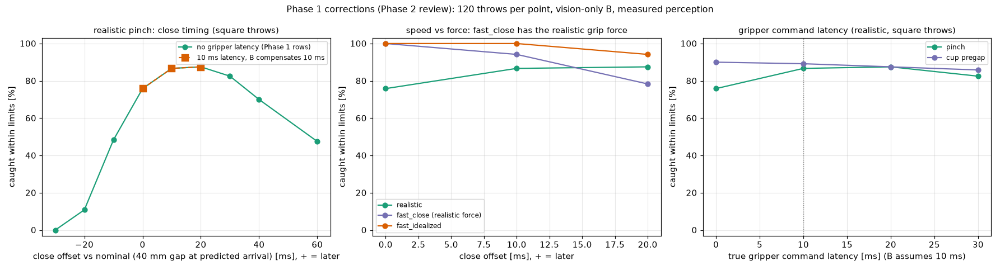
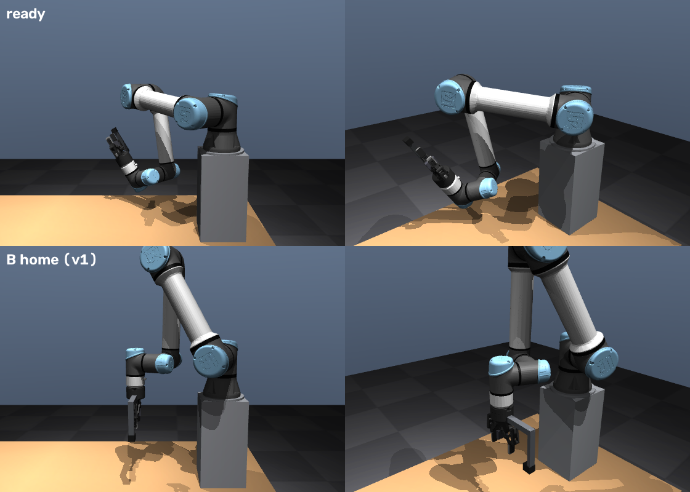
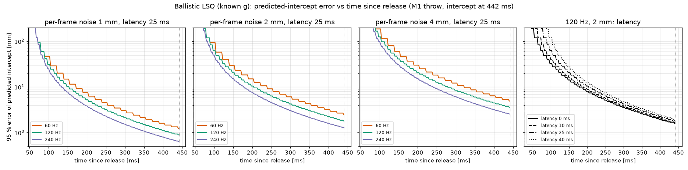
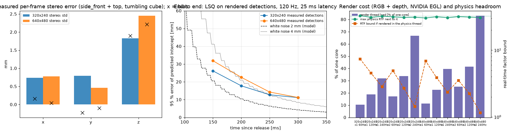
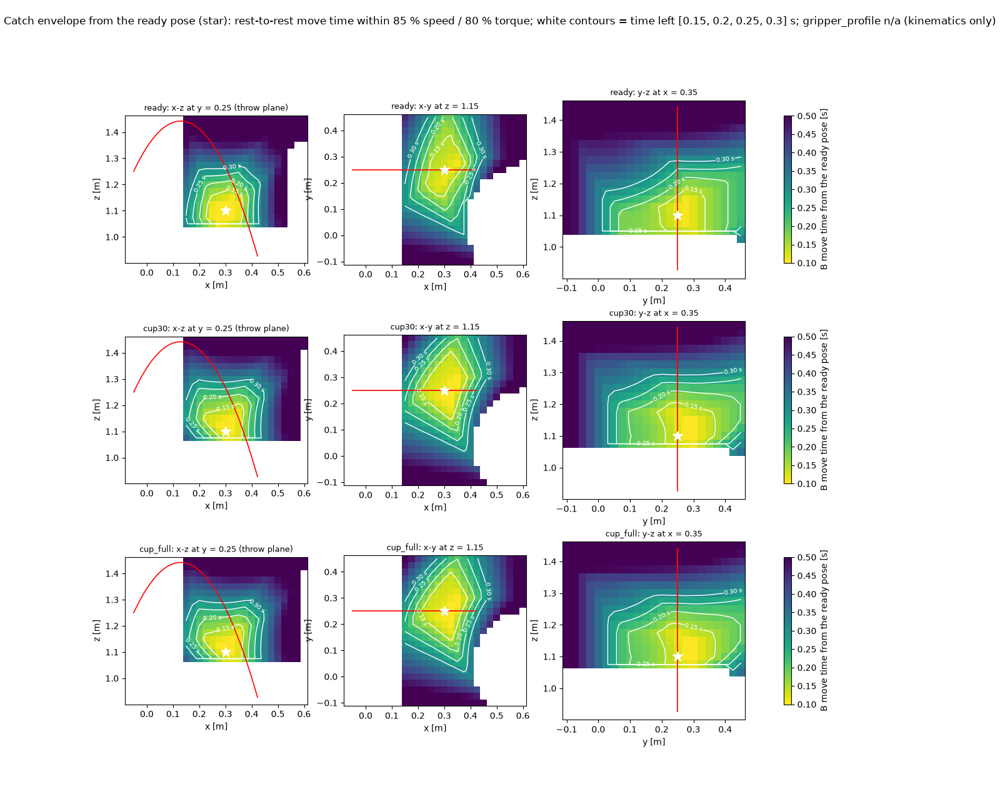
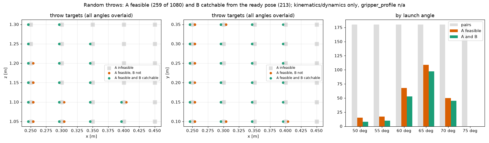
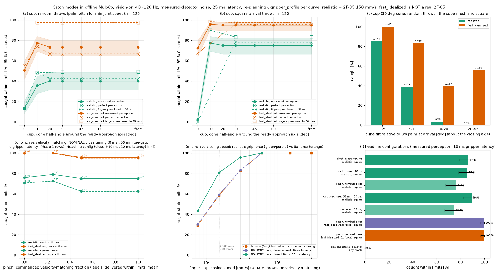

# v2 Phase 1 — offline feasibility: random throws, vision-only catch

Goal of v2: A throws to random targets; B starts from a ready pose, sees the cube only through cameras (no access
to A's plan), moves to intercept and catches — ideally with a "chopsticks" pinch instead of the palm-up cup.
This phase is offline only (MuJoCo Python in `.venv`, the same generated scene the ROS sim loads, the M1/M5
tooling). Nothing in the ROS pipeline changed.

Reproduce (all in `.venv`, config `tools/v2_study.yaml`, results `docs/v2/`):

| Item | Command | Output |
|---|---|---|
| 2 perception | `tools/v2_perception.py --lsq --detect --bench` | `perception_*.json`, `perception_error_vs_time.png` |
| 1 + 3 ready pose, envelope | `tools/v2_ready_envelope.py` (~40 min on 22 cores) | `ready_envelope.json`, `ready_pose.png`, `catch_envelope.png` |
| 4 random throws | `tools/v2_throws.py [--square]`; `--id` (ROS sourced, for xacro) | `throw_distribution[_square].json/png`, `inverse_dynamics.json` |
| 5 catch modes | `tools/v2_catch_sim.py --gripper`, `--cup/--pinch [--throws square]` (resumable) | `gripper_speed.json`, `catch_cup[_square].json`, `catch_pinch[_square].json` |
| plots | `tools/v2_plots.py` | `perception_detection_bench.png`, `catch_modes.png` |

`gripper_profile: realistic | fast_idealized` (default `realistic`) is in `tools/v2_study.yaml`; every result row
and plot carries it. **`fast_idealized` is not a real 2F-85.** Every success rate below says which profile it is.

Limits everywhere (same as M1): joint speed ≤ 85 % of 180 °/s, inverse-dynamics torque (MuJoCo, gravity included)
≤ 80 % of 150/150/150/28/28/28 N·m, ≥ 0.15 rad from the joint limits. A catch only counts if every executed
(re)plan of B stayed inside these limits.

## Corrections after the Phase 1 review (Phase 2, step 0)

**Which configuration each pinch number comes from.** The Phase 1 table quoted 86–87 % for the realistic pinch,
while `catch_modes.png` showed ~75 % (panel f), 71–79 % (d) and 55–71 % at 150 mm/s (e). All are correct for their
configuration; the plots did not say which one, and the headline configuration was not plotted:

| number | close timing | pre-gap | throw set | perception | gripper | latency | source row |
|---|---|---|---|---|---|---|---|
| **87 % / 86 %** (headline) | **+10 ms** after nominal | 56 mm | square / random | measured | realistic | 0 (Phase 1) and 10 ms (now) | `lead\|-10\|…`, `pinch\|realistic\|lead-10` |
| 76 % / 71 % | nominal (gap 40 mm at predicted arrival) | 56 mm | square / random | measured | realistic | 0 | `profile\|realistic\|pinch\|0.0` (old panel f, d) |
| 79 % / 72 % | nominal, 0.25 velocity matching | 56 mm | square / random | measured | realistic | 0 | panel (d) |
| 58 % (old panel e at 150 mm/s) | nominal | 56 mm | square | measured | **fast_idealized actuator (5× force)** ramped at 150 mm/s | 0 | `speed\|150\|pinch\|0.0` |
| 55–71 % (old panel e, 150 mm/s, random/square, match 0/1) | nominal | 56 mm | both | measured | 5× force actuator | 0 | `speed\|150\|…` |

Now: panel (f) of `catch_modes.png` shows the headline configurations (with the 10 ms gripper latency), panel (d)
says it is nominal timing, panel (e) shows the closing-speed sweep with the **realistic** grip force (plus the old 5×
force curve for comparison), and `catch_corrections.png` adds the timing, speed-vs-force and latency sweeps.
The headline is unchanged by the latency model: **87 % (square) / 86 % (random)**, realistic gripper, 10 ms latency.

**Closing speed vs grip force.** `fast_idealized` had 5× the grip force. New profile `fast_close`: the same 10×
commanded speed, the realistic force limit (it reaches ~570 mm/s from 56 mm, force-limited). Pinch, square throws,
120 each: realistic 76 / **87** / 88 % (close nominal / +10 / +20 ms), **fast_close 100** / 94 / 78 %, fast_idealized
100 / 100 / 94 %. Closing-speed sweep with the realistic force (best timing): 75 mm/s 43 %, 150 mm/s 81 %, 300 mm/s
96 %, 600 mm/s 100 %. **The speed effect is a speed effect**: a fast gripper with the 2F-85's force catches 100 %.

**Gripper command latency.** Robotiq 2F-85/2F-140 instruction manual, 4.7.1 Connection Setup: "200 Hz is the usual
speed when commanding / reading from the Robotiq Gripper. It is therefore recommended to send commands with a minimum
delay of 5 ms between them", RS-485 at 115,200 bps. Estimate: ≤ 5 ms to the next command slot + ~2 ms Modbus
transaction + gripper cycle ≈ **10 ms (default; not a measurement)**. Offline: every gripper command reaches the
fingers 10 ms later; a timed close is sent 10 ms early (B's assumed latency). Sweep of the true latency with B
assuming 10 ms (square throws): pinch 76 / 87 / 88 / 82 % at 0 / 10 / 20 / 30 ms (a latency error is a close-timing
error), pre-closed cup 90 / 89 / 88 / 86 % (contact-triggered, cannot be compensated, but the cup is tolerant).

## 1. Ready pose for B

**Search** (`tools/v2_ready_envelope.py`): TCP on a 5 cm grid x 0.20–0.55, y 0–0.25, z 1.10–1.40 around the M5 catch
region; approach axis (tool z) pointing towards A at 0/15/30/45/60° above horizontal; closing axis (tool x) along
world y (across any throw in an x-z plane). All 8 IK branches are evaluated; a branch is *natural* if the elbow is
up, wrist 2 is ≥ 30° from the wrist singularity, every joint is ≥ 0.15 rad from its limit and the arm is ≥ 5 cm
from table, pedestals and pallets; of the natural branches the one closest to B's home in joint space is kept.
1680 poses → 1498 with IK → 1095 with a natural branch. They are scored by what matters for a vision-only
catch: the fraction of a broad prior family of 252 throws (release (−0.05, y, 1.25), y 0.10–0.35, 50–75°, crossing
z = 1.15 at x 0.20–0.50) that B can intercept somewhere on the descending path, from rest, within the limits, in
the time left after the perception decision (0.20 s, item 2), for the natural orientation and for a cup limited
to a 30° cone. 283 poses were scored (best per elevation × x cell, then a refinement around the best cell).

**Chosen ready pose**

| | |
|---|---|
| TCP | **(0.30, 0.25, 1.10)** — in the M1 throw plane, 0.50 m in front of B's base, 10 cm above home's TCP (5 cm in front of and below the M5 catch point) |
| orientation | approach axis 60° above horizontal towards A, closing axis along world y (fingers horizontal, across the flight) |
| joints [rad] | [−0.8797, −0.1119, 1.8912, −2.9975, 1.1753, 3.9499] |
| joint margins [rad] | pan 5.40, lift 6.17, **elbow 1.25** (min), wrist 1 3.29, wrist 2 5.11, wrist 3 2.33 |
| wrist singularity | \|sin(wrist 2)\| = 0.92 (67° away) |
| clearance | 84 mm to table / pedestals / pallets; smallest Cartesian singular value of J 0.27 m |
| prior family catchable (t_decision 0.20 s) | natural orientation 58 %, cup within 30° 54 % |

The render shows elbow up, upper arm out to the side, forearm down, gripper pointing up towards A — no flipped
wrist (wrist 2 has the opposite sign of home's only because home points the gripper straight down).
The score is flat near the optimum (top 10 within 0.03, all x 0.30–0.40, elevation 60°); the tie-break is the
larger joint margin. Lower elevations are natural too but the cup cannot face the cube from them: the random
throws arrive 60–75° below horizontal, so with a 30° cone the cup is catchable for 0 % (elevation 0°), 6–13 %
(30°), 28 % (45°) and 54 % (60°) of the family.

## 2. Perception timing

### 2a. Predicted-intercept error vs time since release (ballistic LSQ, known g)
B fits p(t) = p0 + v0 t + ½ g t² to the cube positions seen so far. The model is linear, so the prediction
covariance is exact (per axis σ²·[1 T](AᵀA)⁻¹[1 T]ᵀ, 95 % 3D = 2.80 σ); a 4000-run Monte Carlo agrees within 1.5 %
(e.g. 120 Hz, 2 mm, 25 ms, t = 0.15 s: 20.5 mm MC vs 20.6 mm). First usable frame 30 ms after release (cube clear
of A's fingers); intercept at 0.442 s (M1 throw).

Time after release at which the 95 % error of the predicted intercept falls below 20 / 10 / 5 mm, latency 25 ms
(other latencies: each 15 ms of latency delays every entry by ≈ 15 ms; full table in `perception_lsq.json`):

| rate | σ = 1 mm | σ = 2 mm | σ = 4 mm |
|---|---|---|---|
| 60 Hz | 140 / 173 / 240 ms | 173 / 240 / 323 ms | 240 / 323 / 440 ms |
| 120 Hz | 115 / 155 / 205 ms | 155 / **205** / 280 ms | 205 / 280 / 380 ms |
| 240 Hz | 105 / 135 / 180 ms | 135 / 180 / 243 ms | 180 / 243 / 328 ms |

At a fixed σ, going 60 → 120 Hz brings the 10 mm point 35 ms earlier and 120 → 240 Hz another 25 ms (error
∝ σ/√N); halving σ is worth more than doubling the rate.

### 2b. What σ is realistic: rendered detections
Two study cameras in the real scene, orthogonal views (`side_front` at (0.15, −1.30, 1.30) looking +y gives x/z,
`top` at (0.15, 0.20, 2.35) looking down gives x/y; a pair facing each other leaves depth badly conditioned), 40
throws with a tumbling cube (3 rad/s per axis, worse than the real ~1.9 rad/s about one axis), HSV segmentation
gated around the predicted pixel (as a tracker would; the red slot borders are otherwise in view), silhouette
centroids triangulated:

| | 320×240 | 640×480 |
|---|---|---|
| per-frame std x / y / z | 0.74 / 0.79 / 1.83 mm | 0.78 / 0.46 / 2.45 mm |
| bias x / y / z | 0.2 / −0.2 / **1.9** mm | 0.1 / −0.1 / **2.2** mm |
| one camera + depth from apparent size | std 6 / **98** / 7 mm | 9 / **126** / 10 mm |
| end-to-end LSQ 95 % at 0.15 / 0.20 / 0.25 / 0.30 s (120 Hz, 25 ms) | 26 / 18 / 13 / 11 mm | 32 / 23 / 14 / 11 mm |

* Two cameras are required: one camera's depth from the 40 mm cube's apparent size is off by ~10 cm.
* 640×480 is not better than 320×240 for this detector (z is dominated by the shading-dependent centroid bias of
  the visible faces, not by pixel quantisation).
* The errors of a tumbling cube are correlated over frames (the visible faces change slowly), so the end-to-end
  error is ~1.7× the white-noise model with the same per-frame σ. A white 1.5 mm + Gauss–Markov 2.0 mm (τ = 0.2 s)
  model reproduces the measured 25/17/13/11 mm (fit); item 5 uses it ("measured detector").

### 2c. Render cost on this laptop (RTX 5060 Laptop, NVIDIA EGL)
The camera plugin (mujoco_ros2_control 0.1.1, `camera_plugin.cpp`) renders on **its own thread**; the control
thread only copies mjData when a frame is due, so physics is not blocked. Measured with the plugin's call sequence
(mjv_updateScene, mjr_render, mjr_readPixels RGB + depth, depth linearisation) in a separate process, next to a
free-running physics process of the full scene (30.9 µs/step alone, i.e. 32× real time):

| | 1 camera | 2 cameras |
|---|---|---|
| 320×240: render time / max fps | 1.35 ms / 740 fps | 2.9 ms / 340 fps |
| 640×480 | 1.6 ms / 620 fps | 3.5 ms / 290 fps |
| achieved at 60 / 120 / 240 Hz | all on rate | all on rate |
| physics max real-time factor next to it | 30–33× (alone 32×) | 31–32× |
| bound if rendered in the physics thread (worst case) | ≥ 2.4× | 1.16× (640×480 @ 240 Hz) – 4.9× |

Rendering is cheap and does not threaten the real-time factor. What is not measured here and is the real Phase 2
risk: the plugin publishes RGB **and** depth for every camera at one shared rate (0.1.1), so raising it to 120 Hz
also renders the two overheads, the side camera and the wrist camera at 120 Hz unless they are switched to the
`polled` policy; two 640×480 cameras at 120 Hz are ~520 MB/s of images+depth through DDS (320×240: ~130 MB/s),
far too much for an rclpy subscriber (the M5/M6 nodes already struggle with 500 Hz joint states).

## 3. Catch envelope from the ready pose

For every point of a 2.5 cm grid: B's IK solution (branch-continuous from the ready pose), then the shortest
synchronized rest-to-rest quintic that keeps joint speed ≤ 85 % and inverse-dynamics torque ≤ 80 % (bisection;
TCP ≥ 10 cm above the table, arm ≥ 2 cm from table/pedestals). Orientation at the intercept: the ready orientation
(natural pinch) or the cup (palm against the arrival velocity, ≤ 30° from the ready axis).

| time left | natural orientation | cup ≤ 30° |
|---|---|---|
| 0.15 s | 3.2 L: x 0.23–0.38, y 0.13–0.40, z 1.05–1.18 | 2.5 L |
| 0.20 s | 7.5 L: x 0.20–0.40, y 0.08–0.45*, z 1.05–1.20 | 7.5 L |
| 0.25 s | 13.4 L: x 0.18–0.43, y 0.03–0.45*, z 1.05–1.25 | 13.9 L |
| 0.30 s | 21.1 L: x 0.15*–0.45, y 0.03–0.45*, z 1.03–1.28 | 22.1 L |

(* = edge of the evaluated grid, the envelope continues.) The floor at z ≈ 1.05 is arm clearance to the table and
pedestal, not reach. With the decision at 0.20 s (120 Hz, 2 mm, 25 ms) and intercepts 0.29–0.49 s after release,
B has 0.09–0.29 s: the envelope is a ~±10–12 cm region around the ready TCP. The fraction of the prior family that
is catchable drops fast with a late decision: 81 % (decide at 0.10 s), 71 % (0.15), 58 % (0.20), 39 % (0.25),
24 % (0.30) — perception latency is directly envelope. Re-planning (item 5) lets B start on a coarse estimate.

## 4. A's random throws

### 4a. Targets A can reach ∩ targets B can catch
Targets (the point the throw passes on the way down): x 0.25–0.45, y 0.10–0.35, z 1.05–1.30 (5 cm), launch angles
50–75°, release at (−0.05, y_target, 1.25) in a throw plane parallel to x; the M1 machinery picks the IK branch and
palm pitch rate, generates the toss (throw.yaml profile, a softer alternative), checks speed ≤ 85 %, torque ≤ 80 %
(MuJoCo inverse dynamics), margins, TCP above the table and A's arm clearance (with B at the ready pose).

| | pairs | A feasible | B catchable (natural / cup 30°) | distribution (A ∩ B both modes) |
|---|---|---|---|---|
| palm pitch for minimum joint speed ("random") | 1080 | 259 | 93 % / 82 % | **213 throws** |
| palm pitch chosen for a square arrival (±5°) | 1080 | 150 | 93 % / 81 % | **121 throws** |

* A's feasible targets: x 0.25–0.40 (x = 0.45 never, x < 0.25 not evaluated), all y 0.10–0.35, z 1.05–1.30;
  launch angles 50–70° (75° never). Rejections: release joint speed (519), stroke joint speed (212), arm clearance
  (90). Distribution: 0.29–0.49 s to the target, 1.45–2.26 m/s, peak joint speed 62–85 %, torque 59–79 % of limit.
* **Square arrival.** Item 5 shows the cup only works when the cube lands square on the palm. In M1 the palm
  pitch rate was tuned so the cube's spin cancels the change of flight direction for the one demo throw; a
  random throw with the minimum-speed pitch rate arrives tilted by anything up to 45°. Choosing the pitch rate
  so the spin squares the cube to B's (cup) palm within ±5° costs A 42 % of its feasible throws (259 → 150; mostly
  release joint speed) and removes 55° and 60° throws; 121 remain (50/65/70°).

### 4b. Throw generation: online inverse dynamics vs a precomputed library

| | |
|---|---|
| online generation (numpy: IK branch + pitch rate 0.7 ms, stroke 31 ms) | 32 ms per throw, 89 samples |
| MuJoCo inverse dynamics per throw (venv) | 1.1 ms |
| pinocchio RNEA (pip `pin` 4.1.0 in the venv) | 2.9 µs per sample (0.26 ms per throw) |
| `ros-jazzy-pinocchio` on packages.ros.org | **yes, 4.1.0-1noble** (not installed; pulls `libboost-all-dev`, `ros-jazzy-coal`, …) |

Torques over 20 distribution throws, pinocchio − MuJoCo `mj_inverse` (gravity included; MuJoCo peaks 27 / 101 /
38 / 5.8 / 0.9 / 0.4 N·m):

| pinocchio model | max \|Δτ\| per joint [N·m] | rms [N·m] |
|---|---|---|
| the MuJoCo parameters (joint placements, body inertias, gripper lumped on wrist 3) + armature | 0.000 (all) | 0.000 |
| URDF = robot_description (ur_description + robotiq_description inertias) | 4.3 / **14.1** / 6.5 / 3.6 / 1.1 / 0.4 | 1.6 / 10.4 / 4.0 / 2.0 / 0.3 / 0.1 |
| URDF + MuJoCo's 0.1 kg·m² rotor inertia | 5.1 / 16.2 / 8.5 / 1.0 / 0.1 / 0.0 | |
| `pin.buildModelFromMJCF` of the same MJCF | up to 39 N·m (its importer gives wrist 3 + gripper ~0.85 kg more mass than MuJoCo compiles) | |

Pinocchio and MuJoCo agree exactly given the same parameters; the URDF a ROS node would naturally load has
different link inertias than the Menagerie model the sim runs (shoulder-lift feed-forward off by up to 14 N·m,
~9 % of the limit) and no rotor inertia.

**Recommendation: a precomputed throw library.** Generate the distribution offline (the existing
`throw_feedforward.py` pattern, MuJoCo inverse dynamics, hashed against its inputs), store trajectory + feed-forward
per throw (121 square-arrival throws × 89 samples × 6 joints ≈ 64 k numbers, one yaml/npz), and let `throw_node` draw
a random entry. Reasons: every throw is limit-checked and can be simulated offline before it is ever executed
(the M4 accuracy checks per throw); no new apt dependency (the system stays untouched; pinocchio would need
`apt install ros-jazzy-pinocchio` + a hand-made parameter file matching the sim, otherwise its torques are the URDF's);
throw generation is not a runtime cost either way (32 ms) but a failed online solve mid-demo is. Randomness is not
lost: 121 (or 213) distinct throws over a 15 × 25 × 25 cm target region; "random targets" in Phase 2 = random
library entries, plus optional small release-velocity noise injected by B's side of the benchmark.

## 5. Catch modes in offline MuJoCo (vision-only B)

`tools/v2_catch_sim.py`, the generated scene, 120 throws sampled from a distribution of item 4 per row
(seed 7). Per trial: the cube is launched with A's release state (position, velocity, A's toss orientation and
spin; A's arm holds home). B starts at the ready pose and knows nothing of the plan:
* **perception:** cube positions at 120 Hz from 30 ms after release with the measured-detector noise (white 1.5 mm
  + Gauss–Markov 2.0 mm, τ 0.2 s; item 2b), available 25 ms later; B fits the ballistic LSQ;
* **planning:** when the predicted 95 % error is ≤ 30 mm (at 139 ms after release with this noise), B picks the
  intercept time on the predicted path with the most limit margin and starts a quintic from rest; it re-plans the
  same intercept time on every new estimate until 40 ms before arrival (reactive intercept);
* **control:** PD with the JTC gains + inverse-dynamics feed-forward on the desired trajectory (the JTC effort
  loop of M2/M4), 500 Hz;
* **success:** 0.8 s after B stops, the cube is at rest between the pads (< 25 mm from the pad centre, knuckle in
  the holding range, off the table) **and** every executed (re)plan stayed within 85 % speed / 80 % torque.
  Cubes gripped further out (at the fingertips) are counted separately as "fingertip grasps", not as catches.

**Gripper profiles** (`gripper_profile`, measured in the sim without a cube, `gripper_speed.json`):

| profile | commanded gap speed | achieved 85 → 40 mm | achieved 56 → 40 mm | notes |
|---|---|---|---|---|
| **realistic** | 150 mm/s (2F-85 max, Robotiq product sheet: closing speed 20–150 mm/s, stroke 85 mm) | 312 ms (145 mm/s) | 117 ms (137 mm/s) | v1 force limit (same grip force as M5) |
| **fast_idealized** (not a real 2F-85) | 1500 mm/s | 36 ms (1256 mm/s) | 16 ms (1000 mm/s) | 5× force limit, so also 5× grip force |
| v1 sim gripper (M5, step command) | — | 93 ms (peak ~720 mm/s) | | 3–5× faster than the real 2F-85 |

The M5 cup's 30/30 was obtained with the v1 sim gripper, i.e. faster than the real hardware can close.

### 5a. Natural cup: success vs cone angle
Palm normal against the predicted arrival velocity, limited to a cone around the ready approach axis (60° up
towards A); fingers fully open (85 mm) or pre-closed to 56 mm; close on the palm touch sensor (+6 ms).

| cone | realistic, random throws | realistic, square throws | fast_idealized, square throws |
|---|---|---|---|
| 0° (ready orientation) | 13 % | 2 % | 72 % |
| 10° | 36 % | 78 % | 96 % |
| 20°–free | 40 % | 75 % | 95 % |
| 10° / 30°, fingers pre-closed to 56 mm | 48 % / 49 % | **90 %** / 83 % | 98 % / 98 % |
| 30°, perfect perception (1 kHz, no noise, no latency) | 42 % | 78 % | 96 % |

* **The cube must land square on the palm.** With the minimum-speed palm pitch the random throws arrive tilted by
  up to 45° about the closing axis; the cup holds 40/47 (realistic) / 47/47 (fast) of the throws that arrive within
  5°, 1/55 / 26/55 of those tilted > 10° (panel c). A tilted cube lands on an edge, rocks and slides off along the
  finger-width direction, which open fingers do not block. Square-arrival throws (item 4) fix most of it.
* **Closing speed is the second limit.** Trace of a realistic drop: the cube sits on the tilted palm and slides
  out sideways 250–300 ms after contact; the real 2F-85 needs ~310 ms to close from fully open. Pre-closing the
  fingers to 56 mm (±8 mm around the cube) cuts the close to ~117 ms: 78 → 90 % (square throws, 10° cone).
* **The cone needs ≥ 10°** (0°: 2 %, the palm is ~9–20° off the arrival direction); beyond 10–20° nothing changes,
  because B's palm can already face the cube.
* **Perception is not the bottleneck** for the cup: perfect perception changes the result within the 95 % CI.

### 5b. Pinch ("chopsticks"): closing axis across the velocity, timed close, velocity matching
Closing axis horizontal across the velocity; approach axis = the natural ready axis (60° up towards A, cone 30°),
so the cube enters between the open fingers from the fingertip side; fingers pre-opened to 56 mm and commanded to
close so the gap reaches the cube width at the predicted arrival (+ an offset); the arm matches a fraction of the
cube's velocity (and gravity) at the intercept within the limits, then decelerates to rest.

| | realistic | fast_idealized |
|---|---|---|
| no velocity matching, close on nominal time (square / random throws) | 76 % / 71 % | **100 % / 100 %** |
| … closing 10 ms later than nominal (square / random) | **87 % / 86 %** | — |
| commanded matching 0.25 → delivered 0.25 (square) | 79 % | 100 % |
| commanded 0.5 / 1.0 → **delivered 0.38 mean (0.30–0.40)** (square) | 75 % | 96 % (5 trials over limits) |
| side chopsticks (approach axis also across the velocity, palm out of the way) | **0 % within limits** (plans need median 4.0×, min 2.5× the limits; 44 % if limits are ignored) | 0 % within limits (74 % ignoring limits) |

Realistic-gripper tuning (square throws, no matching):

| close offset vs nominal [ms] | −60 | −40 | −30 | **−20** | **−10** | 0 | +10 | +20 | +30 |
|---|---|---|---|---|---|---|---|---|---|
| caught | 48 % | 70 % | 82 % | **88 %** | **87 %** | 76 % | 48 % | 11 % | 0 % |
| fingertip grasps | 14 | 20 | 16 | 9 | 11 | 25 | 53 | 89 | 91 |

(negative = later.) Pre-opened gap 46 / 50 / 56 / 64 mm: 69 / 73 / 76 / 78 % (nominal timing) — weak.
Closing speed (fast_idealized actuator for the sweep, square throws, no matching): 75 mm/s 29 %, 150 mm/s 58 %,
300 mm/s 82 %, ≥ 600 mm/s 100 % — a gripper ~4× faster than the 2F-85 would make the pinch essentially certain.

Approach-axis dependence (square throws, close 10 ms late, no matching): ready elevation 60° → 87 % realistic /
100 % fast; 45° → 72 % / 94 %; 30° → 59 % / 62 %. The pinch works because the cube flies *into* the gripper
(towards the palm, which stops it if the fingers are late); the further the approach axis turns away from the
incoming direction, the more it degrades towards the infeasible side chopsticks.

* **Velocity matching cannot be delivered.** From the ready pose, in the 0.25–0.3 s available, the arm can match
  only 30–40 % of a 2–2.5 m/s cube's velocity within 85 % speed / 80 % torque (the move has to accelerate the arm
  *and* stop it again before the table), and that 40 % does not improve the catch (75–79 % realistic; it adds 5
  over-limit throws). The pinch does not need it when the cube flies towards the palm.
* **The pinch does not need a square arrival** (the spin is about the closing axis, which does not change the
  faces the pads squeeze): 86–87 % on both distributions, so it keeps the larger random-throw library (213 vs 121).

## 6. Recommendation

| | Recommendation | Why |
|---|---|---|
| **Ready pose** | TCP (0.30, 0.25, 1.10), approach axis 60° above horizontal towards A, closing axis along y; q = [−0.880, −0.112, 1.891, −2.997, 1.175, 3.950] | best catchable fraction of the throw family (58 % natural / 54 % cup at a 0.20 s decision), 1.25 rad minimum joint margin, 84 mm clearance, elbow up, wrist not flipped; lower elevations cost the cup (and the pinch, 5b) |
| **Cameras** | **2 fixed cameras, orthogonal views (side + top), 320×240, 120 Hz, RGB only**; all other cameras `polled`; detection in C++ (or at least not in an rclpy callback on raw images) | 2 cameras are mandatory (one camera: ~10 cm depth error); 640×480 is not more accurate for a centroid detector; at 120 Hz B commits at 0.14 s (30 mm, measured detector) and the 10 mm point comes at ~0.21 s; 240 Hz gains ~25 ms; render cost negligible (1.4 ms per camera, RTF unaffected); the risk is image transport, not rendering |
| **Throw generation** | **Precomputed, offline-verified library** (trajectory + MuJoCo feed-forward per throw, hashed), random draw at runtime; square-arrival palm pitch if the cup is kept | no new apt dependency, every throw limit-checked and simulatable before use, 32 ms online generation buys nothing; pinocchio would need apt + a model matching the sim (URDF inertias are off by up to 14 N·m) |
| **Catch mode** | **Primary: the natural pinch** (pre-opened 56 mm, close commanded by the controller on predicted arrival + 10 ms, no velocity matching), **baseline: the pre-closed cup** (≥ 10° cone) | realistic 2F-85: pinch 86–87 % on both throw sets, pre-closed cup 90 % but only with square-arrival throws (49 % otherwise); fast gripper: both 98–100 %. Side chopsticks and velocity matching are not feasible within the UR5e limits |

**Answer to "chopsticks instead of the palm-up cup, if physics allows":** partly. A chopsticks catch from the side
(cube crossing between the fingers, arm moving with it) is not possible within the UR5e limits (the approach axis
must turn ~80° in < 0.3 s: plans 2.5–51× over the limits; velocity matching delivers ≤ 40 % of the cube's
velocity). What works is "go to the cube and close" from a natural, raised pose with the fingers pointing up
towards A: the closing axis is across the flight, the fingers are pre-opened and close on the *predicted* arrival
instead of on palm contact; the palm is only a backstop. With the real 2F-85 closing speed this reaches ~87 % in
simulation; it becomes ~100 % only with a gripper ≥ 4× faster than the 2F-85.

### Phase 2 milestones (proposed)
1. **P2.0 — /joint_states CPU fix** (left from v1): throw_node, catcher and run_demo subscribe /joint_states only
   while needed (or read the JTC state topic at a low rate); measure with `tools/node_cpu.py` (target: idle Python
   nodes < 100 % of a core in total) and re-run the M6 regression. Needed before anything at 120 Hz is added.
2. **P2.1 — random throws with noise:** `catch_throw` throw library (square-arrival + minimum-speed sets, offline
   generator + MuJoCo feed-forward + per-entry hash, `throw_node` draws a seeded random entry); optional
   release-velocity noise; M4-style accuracy check over the library (`throw_eval --library`).
3. **P2.2 — vision tracking:** 2 study cameras in `scene.yaml` (side + top, 320×240, 120 Hz, the others polled),
   a C++ (or carefully threaded) cube detector + triangulation + ballistic LSQ publishing a predicted intercept
   with covariance; benchmark against ground truth (target: 95 % intercept error ≤ 20 mm at 0.15 s, ≤ 10 mm at
   0.21 s, end-to-end latency ≤ 25 ms).
4. **P2.3 — reactive intercept:** catcher without `/throw/preview`: ready pose from this study, commit at ≤ 30 mm,
   re-plan on every estimate (JTC trajectory replacement), pinch with the close time-stamped in the gripper
   controller (JTC, like A's loosen — never a Python sleep: ±10 ms matters, 5b), pre-closed cup as fallback mode.
5. **P2.4 — benchmark:** success vs noise (σ 1/2/4 mm), camera rate (60/120/240 Hz) and latency (0–40 ms);
   plan-informed (v1 preview) vs vision-only; cup vs pinch; realistic vs fast_idealized gripper (flagged);
   ≥ 100 throws per cell, Wilson CIs, ground-truth judging as in M5.

### What is infeasible, and why
* **Side chopsticks** (palm out of the cube's way): B's plan exceeds the 85 % speed / 80 % torque limits in every
  trial (8 rows, 960 trials; median 4×): the approach axis has to turn ~80° away from the natural pose (which is
  ~9° from the incoming direction) in the 0.25–0.3 s left after the perception decision.
* **Velocity matching:** ≤ 40 % of the cube's velocity is deliverable within the limits (accelerate in ~0.25 s and
  stop again above the table); it does not improve the catch.
* **Cup with fully open fingers and random-spin throws on a real-speed 2F-85:** 40 % — the cube lands tilted and
  slides out before the fingers close.
* **Single-camera tracking:** depth from apparent size is off by ~10 cm (95 %: 20 cm).
* **A throws to x ≥ 0.45 or 75°:** release joint speed > 85 %; square arrivals cost A 42 % of its feasible throws.

### Uncertainties
* **Contact model.** Every success rate rests on MuJoCo soft contacts (bounce of a 60 g cube on the palm insert,
  pad friction 1.0); the cup/pinch differences are large and consistent, absolute numbers less so.
* **Gripper model.** The realistic profile is a ramp at the spec speed through the Menagerie linkage; the real
  2F-85's acceleration, its Modbus command latency (not modelled, ~10 ms-class) and its object-detection stop are
  not. `fast_idealized` also has 5× the grip force. The close-timing window (±10 ms) is narrow.
* **Perception.** The detector is a simple colour-centroid on rendered images with ideal calibration, no motion
  blur, no rolling shutter, no time-stamp jitter; the noise model was fitted to it. Real cameras will be worse;
  the benchmark (P2.4) should sweep it.
* **Planning model.** Quintics with an IK branch fixed per plan; B's self-collision and collision with the cube's
  path before the intercept are not checked; the JTC is emulated (PD + feed-forward at 500 Hz), not run.
* **Sampling.** 120 throws per row: 95 % CIs are ±6–9 points around 75–90 %; the throw grids (targets x ≥ 0.25, a
  5 cm grid, fixed release point) and the ready-pose grid (5 cm, 15° steps; the optimum sits on a flat plateau)
  are coarse.
* **Rendering vs the ROS plugin.** The render benchmark used the plugin's call sequence in Python with EGL; the
  plugin may use GLFW (M0: it does when a display exists) and adds ROS image publishing, which was not measured.

