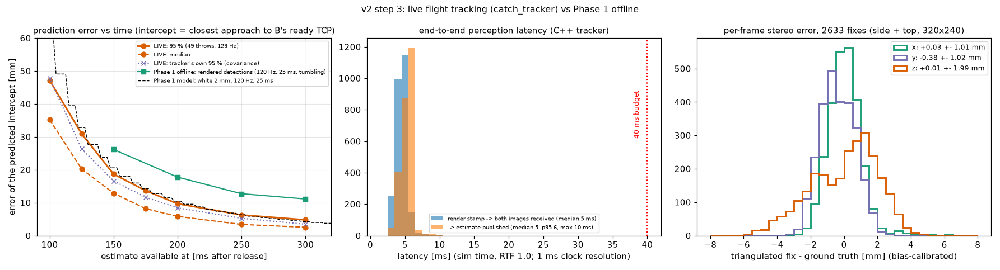

# v2 Phase 2 — random throws, vision-only B, reactive catch from the ready pose

A throws random entries of a precomputed throw library with release noise; B starts from the Phase 1 ready pose,
sees the cube only through two cameras (C++ tracker), commits to an intercept as soon as the prediction is good
enough, keeps refining it by replacing its trajectory at ~40 Hz, and catches with the "pinch" (fingers pre-opened
to 56 mm, close timed on the predicted arrival) — on the live ROS pipeline, with the 2F-85's real closing speed and
command latency modelled. Phase 1 (offline study): `docs/v2_phase1_feasibility.md`.

Defaults everywhere: `gripper_profile: realistic` (2F-85 150 mm/s gap speed, 10 ms command latency). `fast_close`
and `fast_idealized` (NOT a real 2F-85) appear only in the benchmark and are labelled there.

**Key numbers** (live ROS pipeline, 60 throws per cell, ground truth):
* Default — vision-only pinch, medium release noise, realistic 2F-85: **59/59 = 100 % [94–100]** with the sim
  running alone (95 % [86–98] with three sims in parallel); offline with the same measured perception 98 %.
* Plan-informed B (A's published plan) collapses with noise: 98 → 39 → 27 % (none → medium → high); vision-only
  stays at 86–100 %.
* Perception: **5 ms** render → estimate (median), 128.7 Hz, first estimate 47 ms after release, 9.7 mm (95 %)
  intercept error 0.20 s ahead. B commits ~75 ms after the first estimate and re-plans at 39 Hz (4 ms per plan).
* Full loop, 3 seeds, medium noise: **9/9 caught first time, 9/9 placed (≤ 1.1 mm), VERIFY = ground truth 9/9**.

<!-- STEPS -->

## Step 0 — corrections from the Phase 1 review
Details: `docs/v2_phase1_feasibility.md` ("Corrections after the Phase 1 review"), `docs/v2/catch_corrections.png`.
* **Pinch numbers reconciled.** 86–87 % = realistic pinch closing 10 ms after the nominal instant; the plots showed
  nominal timing (76 / 71 %), 0.25 velocity matching and a 5×-force actuator sweep (55–71 % at 150 mm/s). Every panel
  now names its configuration; panel (f) shows the headline configurations.
* **Speed vs grip force.** `fast_close` = 10× speed with the realistic force: 100 % (pinch, nominal close) — the gain
  is closing speed, not force. Realistic-force speed sweep: 75 / 150 / 300 / 600 mm/s → 43 / 81 / 96 / 100 %.
* **Gripper command latency** 10 ms (Robotiq 2F-85/2F-140 manual 4.7.1: "200 Hz is the usual speed when commanding /
  reading … minimum delay of 5 ms between [commands]", RS-485 115.2 kbps → ≤ 5 ms slot + ~2 ms transaction + gripper
  cycle; an estimate, not a measurement), modelled offline and in the sim (`catch_sim/gripper_model.py`). Sweep with
  B assuming 10 ms: pinch 76 / 87 / 88 / 82 %, pre-closed cup 90 / 89 / 88 / 86 % at 0 / 10 / 20 / 30 ms.
* **v1 honesty.** The v1 sim gripper closed ~3× faster than a 2F-85. With the realistic model on both arms the v1
  evaluation still catches **30/30 (placed 30/30)** and M4 throws **20/20, +5.4 ± 1.8 mm/s** — the v1 demo throw lands
  square on a static, plan-informed cup, where the closing speed does not matter (it does for random throws, Phase 1).
  Measured in both runs' recordings (v2.1, `tools/v2_live/v1_close_analysis.py`): 480 vs 150 mm/s reached, pads on
  the cube 108 vs 340 ms after the impact, the cube at rest in the palm (≤ 6 mm drift) until they arrive.

## Step 1 — /joint_states CPU fix
`catch_sim.joint_state_cache.JointStateCache` keeps the latest /joint_states on a helper node spun by an
EventsExecutor thread (the /clock pattern), used by MoveItClient (catcher, run_demo, evals) and throw_node.

| idle, % of one core | before | after |
|---|---|---|
| throw_node | 93.2 | **9.8** |
| catcher | 53.2 | **9.8** |
| run_demo's node | 46.6 | **11.8** |

Regression with the v1 gripper (MJCF variant + profile `v1`, so only the CPU fix differs): M4 20/20, +7.1 ± 2.2 mm/s,
0.28 ± 0.03° (v1: +6.6 ± 2.5, 0.28 ± 0.03); run_demo seed 1 complete R-G-B in 3 throws, verify offsets identical
to v1 to 0.1 mm, 95.7 → 88.3 s.

## Step 2 — random throws
* **Library** (`tools/build_throw_library.py` → `catch_throw/config/library_{pinch,cup}.json`): pinch = all 241
  A-feasible throws B can catch with the natural pinch; cup = the 121 square-arrival throws. Each entry: generation
  parameters, its own MuJoCo feed-forward table, a hash of everything it depends on (throw_node refuses stale entries).
  A picks an entry at random (seeded) via `/throw/preview`; the plan message carries library, entry and stroke-start
  joints so the caller can move A there.
* **Release noise** (`catch_throw/config/v2.yaml`), Gaussian per throw on speed, direction and release time, applied to
  the executed throw; the published plan stays nominal:

| level | speed (1σ) | direction (1σ per axis) | release time (1σ) | basis |
|---|---|---|---|---|
| none | 0 | 0 | 0 | |
| low | 0.12 % | 0.03° | 1 ms | M4's measured scatter |
| medium | 0.6 % | 0.36° | 5 ms | half the plan-informed tolerance across the path (±25 mm/s) |
| high | 1.2 % | 0.72° | 10 ms | that tolerance |

  The realised release error (ground-truth ballistic fit vs the published plan) is recorded in every benchmark trial.
* **Vision-only is enforced.** The reactive catcher's source is fixed per node: with `source=vision` none of its nodes
  subscribes `/throw_plan` or has a `/throw/preview` client (`test_reactive_source.py`); the plan-informed baseline is
  a separate node (`source=plan`, `/reactive_catch_plan`), launched only for the benchmark.

## Step 3 — live vision tracking
* **Cameras:** `track_side` + `track_top` (320×240, colour, orthogonal views), streaming; overheads, side and wrist
  cameras on-demand (polled: pallet_detector triggers at 4 Hz, color_check per request). The camera plugin checks its
  single rate on its own ticks and restarts the timer at "now": a setting of 150 gives **128.7 Hz** (125 → 115 Hz).
* **Detection outside Python:** `catch_tracker` (C++ composable node): HSV components per view; every cross-view pair
  is triangulated and kept only if the two rays meet within 10 mm inside the 3D flight box (the first version used
  a 2D region of interest and picked up pallet slot borders far below the flight volume in the top view: −75 mm
  errors); bias calibrated on 20 separate throws (0.9, 0.4, −0.4 mm); ballistic least squares with known g and
  covariance; predicted intercept (closest point to B's ready TCP) with covariance. The images come from the MuJoCo
  process (camera plugin), so they always cross a process boundary (FastDDS shared memory); intra-process transport is
  not possible without moving detection into the plugin — not needed at the measured latency.
* **50 throws vs ground truth** (`ros2 run catch_tasks tracker_eval`, `docs/v2/phase2/tracker_eval_50.json`):

| | live | Phase 1 offline |
|---|---|---|
| end-to-end latency render stamp → estimate published | **5 ms median, 6 p95, 10 max** | 25 ms assumed |
| — of which render + transport / processing | 5 / 1 ms | |
| camera rate | 128.7 Hz | 120 Hz |
| per-fix error (bias-calibrated) | (0.0, −0.4, 0.0) ± (1.0, 1.0, 2.0) mm | 0.7/0.8/1.8 mm + 1.9 mm z bias (tumbling cube) |
| first fix after release | 47 ms | 30 ms assumed |
| 95 % intercept error at 0.10 / 0.15 / 0.20 / 0.25 / 0.30 s | 47 / 19 / **9.7** / 6.3 / 4.8 mm | – / 26 / 18 / 13 / 11 mm |

The live curve sits on the Phase 1 white-noise model (2 mm, 120 Hz, 25 ms): the lower latency compensates the later
first fix; the Phase 1 rendered-detection estimate (a cube tumbling about all three axes) was pessimistic.

## Step 4 — reactive intercept from the ready pose (pinch)
`catch_catcher/reactive_node.py` (+ `reactive.py`, numpy only), action `/reactive_catch`:
* B waits at the Phase 1 ready pose (TCP (0.30, 0.25, 1.10), approach 60° up towards A) with the fingers at 56 mm.
* **Commit** when the tracker's 95 % intercept error is ≤ 30 mm (~74 ms after the first fix, ~120 ms after release):
  search the predicted descending path for the intercept with the most limit margin — IK + batched inverse dynamics for
  every candidate, collision checks on the feasible ones best first (~20 ms).
* **Refine**: on each new estimate, at most every 20 ms, re-plan the same intercept time from the current desired state
  (quintic, ~4 ms) and replace `arm_b_controller`'s trajectory (JointTrajectory topic, points every 10 ms with
  inverse-dynamics feed-forward; `interpolate_from_desired_state` for continuity) — **~39 Hz** in practice, until
  40 ms before the intercept. A replan that fails late keeps the current plan; B aborts (back to the ready pose) only
  when the predicted intercept leaves the catch envelope.
* **Limits** on every plan: joint speed ≤ 85 %, torque ≤ 80 % (numpy RNEA on the MuJoCo-derived parameters,
  `catch_kinematics.dynamics`, equal to mj_inverse to 1e-6 N·m, test), joint margins.
* **Collisions** on every plan, every 15 ms of the trajectory: capsule model of B (MuJoCo's UR5e capsule geoms
  one-to-one + two fitted gripper capsules) against itself, table / pedestals / pallets and arm A (from A's measured
  joints), `catch_kinematics.collision`. Validated against MuJoCo's collision detection on 4000 random configurations:
  **0 missed collisions**, conservative (21 % of free configurations flagged), 0.2 ms per configuration — fast
  enough, no precomputed safe region needed.
* **Close**: the timed close is scheduled in the gripper controller in advance (sim-time stamp, 2F-85 model ramp; gap
  reaches 40 mm on the predicted arrival + 10 ms, B compensates its assumed 10 ms latency); a palm contact before that
  instant closes immediately. With a 150 mm/s gripper the timed close has to start ~110 ms before the arrival, so in
  the pinch it fires first (the contact trigger only guards an early arrival); in the cup the contact fires first.
  The result says which one fired.
* Smoke test (12 throws, no noise): **12/12**, commit 74 ms after the first fix, 39 Hz replans of 4.4 ms, limit ratio
  ≤ 0.94, plan clearance ≥ 12 mm.

## Step 5 — cup baseline
Same framework, `mode: cup`: palm against the predicted velocity within a 10° cone around the ready axis, fingers
pre-closed to 56 mm, B at rest 30 ms before the arrival, contact close (timed fallback 30 ms after the predicted
arrival), square-arrival throws (cup library). Smoke test (8 throws, no noise): **8/8, contact trigger every time**.

## Step 6 — live benchmark
`tools/v2_live/bench.sh` (15 cells, three ROS domains in parallel; `bench_cell.sh` for one cell), `ros2 run
catch_tasks reactive_eval`, 60 throws per cell, same seeded library entries in every pinch cell, judged on ground
truth (held = cube at rest in the hand < 25 mm from the pad centre, as offline). Table + plots:
`env -u PYTHONPATH .venv/bin/python tools/v2_live/plot_bench.py`. Offline counterparts: `tools/v2_catch_sim.py
--live-match` (MuJoCo, B's controller and planner logic, the **measured** live perception: 128.7 Hz, 5 ms, first fix
47 ms, 1/1/2 mm white noise; exact library throws).

| cell | n | caught | rate [95 % CI] | offline (same config) | outcomes | trigger | commit after 1st fix | replans | realised release error (speed sd, direction rms, time sd; A's execution error median) |
|---|---|---|---|---|---|---|---|---|---|
| vision-only, pinch, noise none | 59 | 55 | **93 %** [84–97] | 98 % [93–99] | held 55, fingertip 3, missed intercept 1, setup 1 | timed 59 | 100 ms | 29.5 Hz | 0.54 % (mean +0.59), 0.24°, 0.0 ms; A's own error 13 mm/s |
| vision-only, pinch, noise low | 59 | 51 | **86 %** [75–93] | 98 % [93–99] | held 51, fingertip 3, abort 2, late close 2, missed intercept 1, setup 1 | timed 57, none 2 | 99 ms | 29.5 Hz | 0.36 % (mean +0.46), 0.22°, 1.0 ms; A's own error 12 mm/s |
| **vision-only, pinch, noise medium (default)** | 59 | 56 | **95 %** [86–98] | 98 % [93–99] | held 56, missed intercept 2, fingertip 1, setup 1 | timed 59 | 102 ms | 29.3 Hz | 1.14 % (mean +0.59), 0.68°, 4.9 ms; A's own error 17 mm/s |
| ... same, sim running alone (no parallel cells) | 59 | 59 | **100 %** [94–100] | 98 % [93–99] | held 59, setup 1 | timed 59 | 73 ms | 39.3 Hz | 1.11 % (mean +0.28), 0.68°, 4.9 ms; A's own error 13 mm/s |
| vision-only, pinch, noise high | 59 | 53 | **90 %** [80–95] | 98 % [93–99] | held 53, fingertip 4, missed intercept 1, abort 1, setup 1 | timed 58, none 1 | 98 ms | 31.4 Hz | 2.05 % (mean +0.59), 1.22°, 9.9 ms; A's own error 20 mm/s |
| plan-informed, pinch, noise none | 58 | 57 | **98 %** [91–100] | — | held 57, setup 2, fingertip 1 | timed 58 | before the throw (A's plan) | — | 0.64 % (mean +0.69), 0.25°, 0.0 ms; A's own error 14 mm/s |
| plan-informed, pinch, noise low | 59 | 58 | **98 %** [91–100] | — | held 58, fingertip 1, setup 1 | timed 59 | before the throw (A's plan) | — | 0.32 % (mean +0.59), 0.24°, 1.0 ms; A's own error 13 mm/s |
| plan-informed, pinch, noise medium | 59 | 23 | **39 %** [28–52] | — | missed intercept 24, held 23, fingertip 11, late close 1, setup 1 | timed 59 | before the throw (A's plan) | — | 1.14 % (mean +0.59), 0.66°, 4.9 ms; A's own error 16 mm/s |
| plan-informed, pinch, noise high | 59 | 16 | **27 %** [17–40] | — | missed intercept 41, held 16, fingertip 2, setup 1 | timed 59 | before the throw (A's plan) | — | 2.03 % (mean +0.66), 1.22°, 9.9 ms; A's own error 22 mm/s |
| vision-only, pre-closed cup (square throws), medium | 57 | 45 | **79 %** [67–88] | 92 % [86–96] | held 45, late close 7, setup 3, missed intercept 2, fingertip 2, abort 1 | contact 53, timed 3, none 1 | 94 ms | 27.3 Hz | 1.20 % (mean +0.60), 0.64°, 4.8 ms; A's own error 17 mm/s |
| ... same, sim running alone | 58 | 49 | **84 %** [73–92] | 92 % [86–96] | held 49, late close 5, setup 2, fingertip 2, missed intercept 2 | contact 56, timed 2 | 76 ms | 35.7 Hz | 1.24 % (mean +0.37), 0.66°, 4.9 ms; A's own error 14 mm/s |
| vision-only, pinch, 64 Hz cameras, medium | 59 | 56 | **95 %** [86–98] | 98 % [94–100] | held 56, abort 2, missed intercept 1, setup 1 | timed 57, none 2 | 91 ms | 31.4 Hz | 1.11 % (mean +0.61), 0.68°, 4.9 ms; A's own error 16 mm/s |
| vision-only, pinch, gripper latency 0 ms (B assumes 10), medium | 58 | 44 | **76 %** [63–85] | 100 % [97–100] | held 44, fingertip 11, missed intercept 2, throw failed 1, setup 1, abort 1 | timed 57, none 1 | 103 ms | 28.6 Hz | 1.17 % (mean +0.67), 0.66°, 5.0 ms; A's own error 18 mm/s |
| ... same, sim running alone | 59 | 59 | **100 %** [94–100] | 100 % [97–100] | held 59, setup 1 | timed 59 | 73 ms | 39.3 Hz | 1.19 % (mean +0.32), 0.69°, 4.9 ms; A's own error 14 mm/s |
| ... latency 20 ms | 58 | 46 | **79 %** [67–88] | 61 % [52–69] | held 46, late close 6, fingertip 5, setup 2, slide-off 1 | timed 58 | 100 ms | 29.5 Hz | 1.15 % (mean +0.58), 0.67°, 4.8 ms; A's own error 16 mm/s |
| ... latency 30 ms | 59 | 34 | **58 %** [45–69] | 52 % [44–61] | held 34, late close 12, fingertip 10, slide-off 2, abort 1, setup 1 | timed 58, none 1 | 98 ms | 29.5 Hz | 1.16 % (mean +0.61), 0.67°, 4.9 ms; A's own error 16 mm/s |
| B's gripper fast_close (NOT a 2F-85; 10x speed, realistic force), medium (ran alone) | 59 | 53 | **90 %** [80–95] | 69 % [60–77] | held 53, fingertip 5, setup 1, late close 1 | timed 59 | 75 ms | 39.3 Hz | 1.14 % (mean +0.27), 0.70°, 4.9 ms; A's own error 13 mm/s |
| B's gripper fast_idealized (NOT a 2F-85; 10x speed, 5x force), medium | 59 | 57 | **97 %** [88–99] | 100 % [97–100] | held 57, setup 1, abort 1, missed intercept 1 | timed 57, none 1, contact 1 | 102 ms | 29.0 Hz | 1.12 % (mean +0.56), 0.66°, 4.9 ms; A's own error 14 mm/s |

"setup" = A could not start the throw (library entry 79: MoveIt fails to reach its stroke start from the load
pose, in every cell; excluded, not a catch attempt); "throw failed" = A refused the throw (one, before the stroke
blend fix; excluded). Offline counterparts have no release noise; for vision-only B
the noise level only moves the intercept around.

### Live vs offline
* **Default configuration (vision-only pinch, medium noise, realistic 2F-85): 100 % [94–100] live with the sim
  running alone, 95 % [86–98] with three sims in parallel, 98 % [93–99] offline.** Vision-only is insensitive to the
  release noise (93 / 86 / 95 / 90 % for none / low / medium / high, all CIs overlapping); plan-informed collapses
  from 98 % to 39 % (medium) and 27 % (high): B commits to A's published plan before the throw and cannot follow
  the realised flight (missed intercepts).
* **Parallel load explains the shortfalls.** Three sims on 24 cores slow B's planner (replans 11–12 ms at ~29 Hz
  instead of 4 ms at 39 Hz; commit ~100 ms instead of 73 ms after the first fix). The one cell more than 15 points
  below offline, **gripper latency 0 ms (76 % vs 100 %), catches 59/59 = 100 % run alone.** Mechanism (recorded
  failures, `tools/v2_live/close_timing.py`): with the true latency 10 ms shorter than B assumes, the fingers reach 40 mm
  10 ms after the arrival instead of ~20 ms after it (see the timing check), so a cube a few millimetres off-centre is caught by the fingertips 33–44 mm
  out of the hand (fingertip) — the slower replanning under load leaves those few millimetres. The pre-closed cup:
  79 % parallel, **84 % [73–92] alone, 92 % [86–96] offline** (CIs overlap): the contact-triggered close of a 150 mm/s
  gripper fires on the arrival but needs ~117 ms (10 ms latency + 16 mm) — the cube rebounds out first (late close).
* **Timing check.** In every recorded failure the gap reaches 40 mm ~10 ms later than B schedules (latency 0 / 10 / 20
  / 30 → +10 / +19 / +30 / +39 ms after the arrival): the MuJoCo finger actuator lags its reference ramp by kv/kp =
  10 ms, offline and live alike.
* **Gripper latency** (true latency varied, B assumes 10 ms): live 76 (100 alone) / 95 / 79 / 58 %, offline 100 / 98 /
  61 / 52 % for 0 / 10 / 20 / 30 ms — a late close loses the cube (late close, rebound), an early one is tolerated only
  with good aim.
* **Closing speed is the limit, not force.** B's gripper alone made faster (NOT a real 2F-85): fast_close (10×
  speed, realistic force) 90 %, fast_idealized (10× speed, 5× force) 97 % — vs 95–100 % for the realistic gripper
  with the timed pinch close. The pinch already hides the 2F-85's slowness by starting the close ~110 ms early.
  Open discrepancy: offline fast_close is lower (69 %) with more closes on a cube that has rebounded off the palm
  (25 of 120 vs 5 of 59 live); not resolved.
* **Cameras at 64 Hz**: 95 % (offline 98 %), the same as at 128.7 Hz under the same load.
* Earlier versions of three cells were wrong and were re-run: high-noise throws whose perturbed stroke started
  > 0.05 rad from the nominal start were refused by throw_node (now blended in, ≤ 6 rad/s², and A's refusals are
  excluded as "throw failed"); the fast_close / fast_idealized cells had also given A's gripper the fast actuator
  (A's release then changed: −23 ± 55 mm/s; 32 aborts) — now only B's gripper varies (`mjcf_variant.py --arms b`,
  `CATCH_GRIPPER_ARMS=b`). Old results: `log/p2/bench_v0/`.

### Failure taxonomy (ground truth, `reactive_eval.classify`)
| class | meaning | where it happens |
|---|---|---|
| fingertip | gripped, 25–50 mm out of the hand | early close (latency 0 under load), late close after a rebound (latency 20/30) |
| late close | came within 30 mm, fingers closed on nothing | true latency > assumed (20/30 ms), contact-triggered cup |
| slide-off | gripped, then lost | rare (latency 20/30) |
| missed intercept | never within 30 mm of the TCP | plan-informed with noise (the realised flight differs from the plan) |
| abort | no feasible intercept in the envelope | rare (≤ 2 per cell): throws whose intercept lies at the envelope edge |
| collision | B's capsule clearance < 0 on the recorded motion | **never** (planner checks every plan) |

Clips (0.25×, catch view; `tools/v2_live/render_failures.py`): see `docs/v2/phase2/failure_clips.json`.

### Latency budget (vision-only pinch, sim alone, medians)
| | time |
|---|---|
| release → first estimate (cube in both views, 5 consistent fixes) | 47 ms |
| render stamp → estimate published (included above) | 5 ms |
| first estimate → commit (95 % intercept error ≤ 30 mm) | 73 ms (≈ 120 ms after release) |
| commit → first trajectory to arm_b_controller (search + commit lead) | ≈ 20 + 30 ms |
| re-plans until 40 ms before the arrival | 8 (6–10) × 4.3 ms, 39 Hz |
| timed close command → gap 40 mm | 108.7 ms (10 ms latency + 2 ms + 16 mm at 150 mm/s) + ~10 ms actuator lag |
| arrival after release | 0.29–0.49 s (median 0.41 s) |
So the close is commanded ~0.30 s after release, ~180 ms after the commit — the 2F-85 closing time (~120 ms) is the
largest single item; perception is 5 ms.

## Step 7 — full loop with random throws, vision-only pinch
`ros2 run catch_tasks run_demo --seed N` is v2 by default (`--v1` = the v1 loop): DETECT → PICK → LOAD (A picks a
random library entry, seeded, and moves to its stroke start) → PREPOSITION (B to the ready pose, fingers at 56 mm,
watching the cameras only) → THROW (medium release noise) + reactive pinch catch → COLOR (wrist camera) → IN_HAND →
PLACE → VERIFY. Recorded batch: `tools/v2_live/run_demo_v2.sh 1 2 3` (fresh sim per seed, rosbag2 →
`bag_to_npz`); ground-truth check `tools/analyze_runs.py` → `docs/v2/phase2/demo/verify_vs_ground_truth.jsonl`.

| seed | order (random) | throws | caught first time | recoveries | duration (sim) | VERIFY vs ground truth | final cube offset in slot (ground truth) |
|---|---|---|---|---|---|---|---|
| 1 | red, green, blue | 3 | 3/3 | 0 | 86.2 s | 3/3 | ≤ 0.7 mm |
| 2 | green, blue, red | 3 | 3/3 | 0 | 91.9 s | 3/3 | ≤ 1.1 mm |
| 3 | blue, red, green | 3 | 3/3 | 0 | 85.8 s | 3/3 | ≤ 0.8 mm |

All 9 catches: timed pinch close, commit 64–78 ms after the first estimate, 8–12 re-plans at 39 Hz of 3.6–4.6 ms;
B's wrist camera named the right color 9/9; RTF 1.000. Cubes held up to 21° tilted in the hand were placed square
(the in-hand correction). VERIFY's own offsets (−4.5…+1.4 mm) are overhead-detection error; the ground-truth
placement error is ≤ 1.1 mm.

Two bugs surfaced only here (the benchmark never triggers the wrist camera): mujoco_ros2_control 0.1.1 aborted the
whole sim on the first wrist-camera trigger (a polled camera listed after a `disabled` one — the plugin's buffers
skip disabled cameras but triggers index by MJCF order; the demo camera is now polled), and color_check rejected the
triggered frame because the plugin stamps it with the rendered physics time, a few ms before the request (freshness
is now "arrived after the trigger").

Demo video: [`media/demo_v2_seed1.mp4`](media/demo_v2_seed1.mp4) (seed 1: B starts from the ready pose and moves to
each cube; real time around each throw, 0.25× close-up of each catch). Failure clips from the benchmark:
`media/v2_fail_*.mp4` (`v2/phase2/failure_clips.json`).

## What is still idealized
* **Cameras**: noise-free renders, fixed lighting, ideal calibration (the tracker's 1–2 mm per-fix error is pixel
  quantisation and colour segmentation only); 128.7 Hz with a 5 ms render-to-estimate latency — a real global-shutter
  pair at 120 Hz with exposure, transport and synchronisation would add tens of ms (Phase 1 assumed 25 ms and still
  reached 87 %).
* **Gripper**: the 2F-85 is modelled (150 mm/s, 10 ms command latency from the manual's command rate — not measured on
  hardware); the MuJoCo position actuator adds ~10 ms of ramp lag. Contact (soft MuJoCo contacts, rigid pads) decides
  rebounds; real pads and cube materials differ.
* **Arms**: torque-controlled JTCs at 500 Hz with exact-model feed-forward (a real UR5e takes position/velocity
  targets through its own controller); joint states are exact; B's plan limits (85 % speed, 80 % torque) are checked
  against the same model that simulates it.
* **Release noise** is Gaussian and independent per throw (speed, direction, timing), sized from M4's scatter and
  the plan-informed tolerance — not measured on a real thrower.
* **Compute**: one machine, sim alone for the headline; catch rates drop with load (95 % with three sims).
* Still from v1: pedestals, scene reset after a drop (teleport), ideal palm force sensor.

## Next steps
1. Camera realism: exposure blur, latency and jitter injected into the tracker input (the offline study's 25 ms
   assumption costs ~10 points); then a real stereo pair.
2. Make the close robust to latency error: measure the gripper's latency online (command → finger motion) and
   adapt the schedule; the benchmark shows a 10 ms error in either direction costs 20–40 points under load.
3. Run B's planner and the tracker on a real-time budget (separate cores / C++ planner) so the parallel-load
   degradation disappears.
4. Cup on random throws (today: square-arrival library only) and a learned or tuned contact trigger.
5. Hardware: the UR5e's position interface instead of torque control, re-identified dynamics, the real 2F-85.

